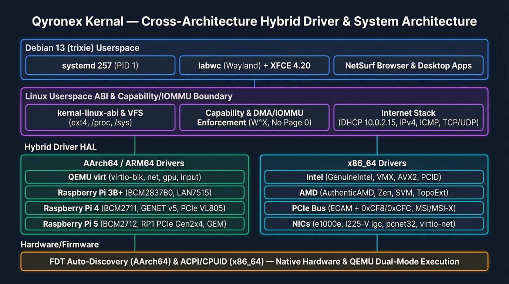

# Qyronex Kernal

[Deutsche Dokumentation](README_DE.md) · [German documentation index](docs/de/README.md) · [Technical dissertation-style monograph](docs/de/DISSERTATION_QYRONEX_KERNAL.md)

**Qyronex Kernal** is an experimental capability-oriented hybrid kernel written primarily in Rust. It was designed and built by **Moritz Wallinger**.

The project explores a small privileged core, explicit capability-based authority, protected userspace execution, and Linux userspace ABI compatibility while deliberately avoiding the assumption that Linux's internal kernel architecture must be reproduced.

> **Development status:** active research and development. Kernal is not production-ready and must not yet be used as a production security boundary.



## Core goals

- Keep privileged and unsafe code as small and auditable as possible.
- Make authority explicit through capabilities instead of relying only on ambient global access.
- Enforce strict memory, execution, ownership, and lifecycle boundaries.
- Provide Linux userspace compatibility through a compatibility layer rather than by copying Linux internals.
- Keep architecture-specific mechanisms separated from architecture-neutral policy.
- Make important runtime behavior reproducible and testable in QEMU.

## Current platforms & hybrid driver layer

Qyronex Kernal runs as a **multi-architecture hybrid kernel** across **AArch64 / ARM64** and **x86_64**, keeping hardware-specific drivers isolated behind a capability- and IOMMU-mediated driver layer (`MmioBus` / `PciConfigBus` / FDT & CPUID discovery) so the same kernel boots both in QEMU and on real-hardware register layouts:

- **AArch64 / ARM64 (QEMU `virt` & Raspberry Pi 3B+ / 4 / 5):**
  - Protected EL0 execution, AArch64 exception/syscall/context handling, TTBR0/TTBR1 virtual memory, ELF loading, signals, futexes, epoll, VFS (`initramfs`, `memfs`, `ext4`), FDT discovery (`firmware/fdt-aarch64`), and VirtIO (`virtio-blk`, `virtio-net`, `virtio-gpu`, `virtio-input`).
  - **Raspberry Pi 3B+ (`BCM2837B0`)**, **Raspberry Pi 4B (`BCM2711`, `GENET v5`, `PCIe 2.0 -> VIA VL805`, `EMMC2`)**, and **Raspberry Pi 5 (`BCM2712`, `PCIe Gen2x4 -> RP1 Southbridge`, `Cadence GEM`, `Dual xHCI`, `RIO GPIO`)** in `drivers/rpi3b-plus`.
- **x86_64 (Intel & AMD CPUs, UEFI + ACPI + SMP):**
  - CPUID vendor & feature detection (`GenuineIntel` VMX/AVX2/PCID/INVPCID and `AuthenticAMD` Zen/SVM/TopoExt/1GiB pages) in `kernel/arch-x86_64`, APIC/IOAPIC SMP boot (1/2/4 vCPUs), and x86 legacy PCI port I/O (`0xCF8`/`0xCFC`) + PCIe ECAM (`drivers/pci`).
- **PCIe & Networking / Internet:**
  - PCIe Gen1–Gen5 capability & MSI/MSI-X decoding (`drivers/pci`) and NIC profiles (`e1000`, `e1000e`, `I225-V`, `pcnet32`, `RTL8168`, `virtio-net`, `LAN7515`, `BCM2711 GENET v5`, `RP1 Cadence GEM`) with IPv4/DHCP/ICMP/TCP/UDP stack (`kernel/linux-hardware`).

Linux compatibility targets the **userspace ABI**. Linux kernel modules are not a compatibility target.

**Current milestone:** an unchanged Debian 13 (trixie/arm64) userspace with systemd 257 boots on Kernal in QEMU, and a labwc (Wayland) + XFCE 4.20 desktop with NetSurf browser and desktop icons starts via `qyronex-desktop.service`. An installable Raspberry Pi ISO (`qyronex-rpi-installer.iso`) and flashable SD-card image (`qyronex-rpi-sdcard.img`) can be built via `tools/build-rpi-iso.sh`. See [STATUS.md](STATUS.md) for the verified state, known gaps and how to run it.


## System Architecture & Diagrams

| System Layer | Diagram | Documentation |
|---|---|---|
| **Cross-Arch Hybrid Driver Layer** | [Hybrid Driver Architecture](docs/assets/qyronex_hybrid_driver_architecture.png) | [Hardware & Drivers (DE)](docs/de/HARDWARE_UND_TREIBER.md) |
| **Memory Layout, Capabilities & IOMMU** | [Memory, Capability & IOMMU](docs/assets/qyronex_memory_capability_iommu.png) | [Memory Layout](docs/MEMORY_LAYOUT.md) · [DE](docs/de/SPEICHERLAYOUT.md) |
| **Linux Userspace ABI & VFS** | [Linux ABI & VFS](docs/assets/qyronex_linux_abi_and_vfs.png) | [Debian 13 Compatibility (DE)](docs/de/DEBIAN_13_KOMPATIBILITAET.md) |
| **x86_64 SMP, PCIe & Internet Stack** | [x86_64, PCIe & Internet](docs/assets/qyronex_x86_pcie_internet_stack.png) | [x86_64, PCIe & Network (DE)](docs/de/X86_PCIE_UND_NETZWERK.md) |
| **Raspberry Pi 3B+ / 4 / 5 SoC Stack** | [RPi Hardware Stack](docs/assets/qyronex_rpi_hardware_stack.png) | [Hardware & Drivers (DE)](docs/de/HARDWARE_UND_TREIBER.md) |
| **Wayland (`labwc`) & XFCE 4.20 Desktop** | [Desktop Graphics Stack](docs/assets/qyronex_desktop_wayland_stack.png) | [Desktop & Graphics (DE)](docs/de/DESKTOP_UND_GRAFIK.md) |
| **Installable ISO & MBR SD-Card Layout** | [RPi Boot & ISO Layout](docs/assets/qyronex_rpi_boot_iso_layout.png) | [Boot Protocol](docs/BOOT_PROTOCOL.md) · [DE](docs/de/BOOT_PROTOKOLL.md) |

## Build & Raspberry Pi ISO

The workspace currently pins Rust **1.98.0**.

```bash
rustup toolchain install 1.98.0 --profile minimal --component rust-src,rustfmt,clippy,llvm-tools-preview
rustup target add --toolchain 1.98.0 aarch64-unknown-none-softfloat x86_64-unknown-none x86_64-unknown-uefi
cargo xtask arm-build
```

Build the installable Raspberry Pi ISO (`dist/qyronex-rpi-installer.iso`) and flashable SD-card image (`dist/qyronex-rpi-sdcard.img`):

```bash
bash tools/build-rpi-iso.sh
```

## Run in QEMU

```bash
cargo xtask arm-qemu    # AArch64 runtime & filesystem proofs
cargo xtask qemu        # x86_64 1-vCPU UEFI/SMP/PCIe proof
cargo xtask qemu-smp    # x86_64 2- and 4-vCPU SMP proofs
```

## Verification

```bash
./tools/docker/verify-in-docker.sh all
```

The verification pipeline covers formatting, strict Clippy checks, all host/workspace unit tests, `x86_64` QEMU boots (1, 2, 4 vCPUs), and `AArch64` QEMU runtime proofs.

## Repository structure

```text
.
├── abi/        Linux and native ABI definitions
├── boot/       boot, ELF, mapping, UEFI and handoff support
├── drivers/    device-driver components
├── firmware/   ACPI/FDT and platform parsing
├── kernel/     kernel subsystems and architecture backends
├── tests/      integration and compatibility tests
├── tools/      build, verification and research utilities
├── xtask/      Rust build/QEMU orchestration
└── docs/       technical documentation
```

## Documentation

- [German documentation overview](docs/de/README.md)
- [German dissertation-style technical monograph](docs/de/DISSERTATION_QYRONEX_KERNAL.md)
- [Project status](STATUS.md)
- [Debian 13 compatibility roadmap](DEBIAN_13_COMPATIBILITY_ROADMAP.md)
- [Secure storage architecture](SECURE_STORAGE_ARCHITECTURE.md)
- [Boot protocol](docs/BOOT_PROTOCOL.md)
- [Memory layout](docs/MEMORY_LAYOUT.md)

## Security principles

Kernal uses fail-closed design rules: unsafe code should remain narrow and documented; writable/executable mappings must not coexist; page zero stays unmapped; user-memory access is explicit; object authority should be capability-mediated; unsupported Linux operations must fail explicitly rather than report fake success.

These are design goals and architecture contracts, not a claim of a completed production security audit.

## Author

Qyronex Kernal was designed and built by **Moritz Wallinger**. See [AUTHORS.md](AUTHORS.md).

## License

Qyronex Kernal is distributed under the **Qyronex Kernal Non-Commercial License 1.0**. Private, educational, academic and other qualifying non-commercial use is permitted under the license terms. **Commercial use is prohibited unless a separate written commercial license has been granted.**

See [LICENSE](LICENSE) for the controlling license text.
