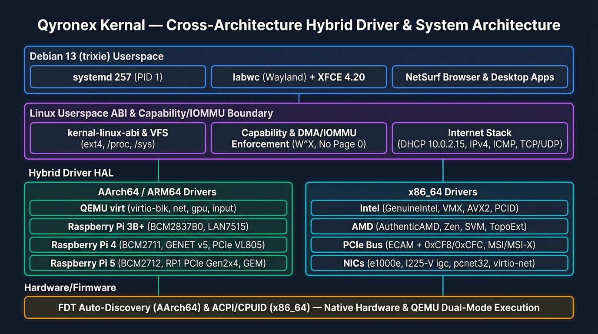

# Qyronex Kernal

[Dokumentation auf Deutsch](docs/de/README.md) · [Dissertationsartige technische Arbeit](docs/de/DISSERTATION_QYRONEX_KERNAL.md) · [English README](README.md)

**Qyronex Kernal** ist ein experimenteller, Capability-orientierter Hybrid-Kernel, der überwiegend in Rust entwickelt wird. Das Projekt wurde von **Moritz Wallinger** entworfen und gebaut.

Ziel ist ein kleiner privilegierter Kern mit expliziter Capability-basierter Rechtevergabe, geschützter Userspace-Ausführung, klaren Speicher- und Ownership-Grenzen sowie einer Linux-kompatiblen Userspace-ABI, ohne die interne Architektur des Linux-Kernels nachbauen zu müssen.

> **Status:** aktive Forschung und Entwicklung. Kernal ist nicht produktionsreif und darf derzeit nicht als produktive Sicherheitsgrenze eingesetzt werden.


## Ziele

- Privilegierten und unsicheren Code möglichst klein und überprüfbar halten.
- Rechte explizit über Capabilities statt ausschließlich über implizite globale Autorität vergeben.
- Speicher-, Ausführungs-, Ownership- und Lebenszyklusgrenzen konsequent durchsetzen.
- Linux-Userspace-Kompatibilität über eine klar abgegrenzte Kompatibilitätsschicht bereitstellen.
- Architekturspezifische Mechanismen von architekturneutraler Policy trennen.
- Zentrale Runtime-Eigenschaften reproduzierbar in QEMU testen.

## Aktuelle Plattformen & Hybrid-Treiberschicht

Qyronex Kernal ist ein **Multi-Architektur-Hybridkernel** für **AArch64 / ARM64** und **x86_64**, bei dem Hardware-Treiber sauber hinter einer Capability- und IOMMU-vermittelten Treiberschicht (`MmioBus` / `PciConfigBus` / FDT- & CPUID-Erkennung) gekapselt sind. Dadurch läuft derselbe Kernel sowohl in QEMU als auch auf nativen Hardware-Registerlayouts:

- **AArch64 / ARM64 (QEMU `virt` & Raspberry Pi 3B+ / 4 / 5):**
  - geschützte EL0-Userspace-Ausführung, AArch64-Exceptions/Syscalls, TTBR0/TTBR1-Speicherverwaltung, ELF-Loading, Signale, Futexe, epoll, VFS (`initramfs`, `memfs`, `ext4`), FDT-Auto-Discovery (`firmware/fdt-aarch64`) und VirtIO (`virtio-blk`, `virtio-net`, `virtio-gpu`, `virtio-input`);
  - **Raspberry Pi 3B+ (`BCM2837B0` + `LAN7515`)**, **Raspberry Pi 4B (`BCM2711`, `GENET v5`, `PCIe 2.0 -> VIA VL805`, `EMMC2`)** und **Raspberry Pi 5 (`BCM2712`, `PCIe Gen2x4 -> RP1 Southbridge`, `Cadence GEM`, `Dual xHCI`, `RIO GPIO`)** in `drivers/rpi3b-plus`.
- **x86_64 (Intel- & AMD-Prozessoren, UEFI + ACPI + SMP):**
  - CPUID-Vendor- & Feature-Erkennung (`GenuineIntel` VMX/AVX2/PCID/INVPCID sowie `AuthenticAMD` Zen/SVM/TopoExt/1GiB-Pages) in `kernel/arch-x86_64`, APIC/IOAPIC-SMP-Boot (1/2/4 vCPUs) sowie x86 Legacy-PCI-Port-I/O (`0xCF8`/`0xCFC`) + PCIe ECAM (`drivers/pci`).
- **PCIe & Netzwerk / Internet:**
  - PCIe-Gen1–Gen5-Capability- & MSI/MSI-X-Dekodierung (`drivers/pci`) sowie NIC-Treiberprofile (`e1000`, `e1000e`, `I225-V`, `pcnet32`, `RTL8168`, `virtio-net`, `LAN7515`, `BCM2711 GENET v5`, `RP1 Cadence GEM`) inklusive IPv4/DHCP/ICMP/TCP/UDP-Stack (`kernel/linux-hardware`).

Die Linux-Kompatibilität zielt auf die **Userspace-ABI**. Linux-Kernelmodule sind kein Kompatibilitätsziel.

**Aktueller Meilenstein:** Ein unverändertes Debian-13-Userspace (trixie/arm64) mit systemd 257 bootet auf Kernal in QEMU, und ein labwc- (Wayland) + XFCE-4.20-Desktop mit NetSurf-Browser und klickbaren Desktop-Icons startet über `qyronex-desktop.service`. Eine installierbare Raspberry-Pi-ISO (`qyronex-rpi-installer.iso`) sowie ein direkt flashbares SD-Karten-Image (`qyronex-rpi-sdcard.img`) werden über `tools/build-rpi-iso.sh` erzeugt. Siehe [docs/de/STATUS.md](docs/de/STATUS.md) für den geprüften Stand und das Starten.



## Systemgrafiken (Raspberry Pi, x86_64 & ISO-Layout)

| Systembereich | Grafik |
|---|---|
| **Hybrid-Treiberschicht (x86_64 & AArch64)** | [Hybrid-Treiberarchitektur](docs/assets/qyronex_hybrid_driver_architecture.png) |
| **Raspberry Pi 3B+ / 4 / 5 Hardware-Stack** | [Raspberry Pi Hardware-Stack](docs/assets/qyronex_rpi_hardware_stack.png) |
| **Installierbare ISO & MBR-SD-Karten-Layout** | [Raspberry Pi Boot- & ISO-Layout](docs/assets/qyronex_rpi_boot_iso_layout.png) |

## Voraussetzungen

Das Workspace verwendet derzeit Rust **1.98.0**.

```bash
rustup toolchain install 1.98.0 --profile minimal --component rust-src,rustfmt,clippy,llvm-tools-preview
rustup target add --toolchain 1.98.0 aarch64-unknown-none-softfloat x86_64-unknown-none x86_64-unknown-uefi
```

Zusätzlich wird QEMU (`qemu-system-aarch64` / `qemu-system-x86_64`) oder Docker benötigt.

## Bauen & Raspberry-Pi-ISO erstellen

```bash
cargo xtask arm-build
bash tools/build-rpi-iso.sh   # erzeugt dist/qyronex-rpi-installer.iso & dist/qyronex-rpi-sdcard.img
```

## In QEMU starten

```bash
cargo xtask arm-qemu    # AArch64 Runtime- & Dateisystem-Tests
cargo xtask qemu        # x86_64 1-vCPU UEFI/SMP/PCIe-Proof
cargo xtask qemu-smp    # x86_64 2- und 4-vCPU SMP-Proofs
```

## Verifikation

```bash
./tools/docker/verify-in-docker.sh all
```

Der vollständige Prüfpfad umfasst Formatprüfung, striktes Clippy, alle Workspace-Unit-Tests, `x86_64`-QEMU-Boots (1, 2 und 4 vCPUs) sowie die `AArch64`-QEMU-Tests.

## Repository-Struktur

```text
.
├── abi/        Linux- und native ABI-Definitionen
├── boot/       Boot-, ELF-, Mapping-, UEFI- und Handoff-Code
├── drivers/    Treiberkomponenten
├── firmware/   ACPI/FDT und Plattform-Parsing
├── kernel/     Kernel-Subsysteme und Architektur-Backends
├── tests/      Integrations- und Kompatibilitätstests
├── tools/      Build-, Prüf- und Forschungswerkzeuge
├── xtask/      Rust-Build- und QEMU-Orchestrierung
└── docs/       technische Dokumentation
```

## Deutsche Dokumentation

Die zusätzliche deutschsprachige Dokumentation befindet sich unter [`docs/de/`](docs/de/). Dort sind Architektur, Boot, Speicherlayout, Roadmap, Debian-Kompatibilität und sichere Speicherarchitektur zusammengefasst.

Die ausführliche wissenschaftlich aufgebaute Projektarbeit befindet sich unter:

- [`docs/de/DISSERTATION_QYRONEX_KERNAL.md`](docs/de/DISSERTATION_QYRONEX_KERNAL.md)

## Sicherheitsprinzipien

- Unsicheren Rust-Code klein, lokal und mit `SAFETY:`-Begründung halten.
- Keine gleichzeitig schreibbaren und ausführbaren Speicherabbildungen.
- Seite 0 bleibt nach Übernahme der Seitentabellen ungemappt.
- User-Memory-Zugriffe sind begrenzt und explizit.
- Kernelobjekte sollen Capability-vermittelte Autorität verwenden.
- Nicht unterstützte Linux-Operationen müssen sichtbar fehlschlagen und dürfen keinen Erfolg vortäuschen.
- Kompatibilitätsarbeit darf zentrale Speicher-, Lifecycle-, DMA- oder Autoritätsinvarianten nicht schwächen.

Diese Punkte sind Architekturziele und Verträge. Sie stellen keine Behauptung dar, dass bereits ein vollständiges produktives Sicherheitsaudit abgeschlossen wurde.

## Autor

**Qyronex Kernal wurde von Moritz Wallinger entworfen und gebaut.**

Weitere Angaben befinden sich in [`AUTHORS.md`](AUTHORS.md).

## Lizenz

Qyronex Kernal steht unter der **Qyronex Kernal Nicht-Kommerziellen Lizenz 1.0**.

Nicht-kommerzielle private, schulische, akademische und entsprechend der Lizenz zulässige Forschungsnutzung ist erlaubt. **Kommerzielle Nutzung, produktive Unternehmensnutzung, Einbindung in bezahlte Produkte oder Dienste und andere gewerbliche Verwendung sind ohne separate schriftliche Lizenz untersagt.**

Der vollständige verbindliche Lizenztext befindet sich in [`LICENSE`](LICENSE).
