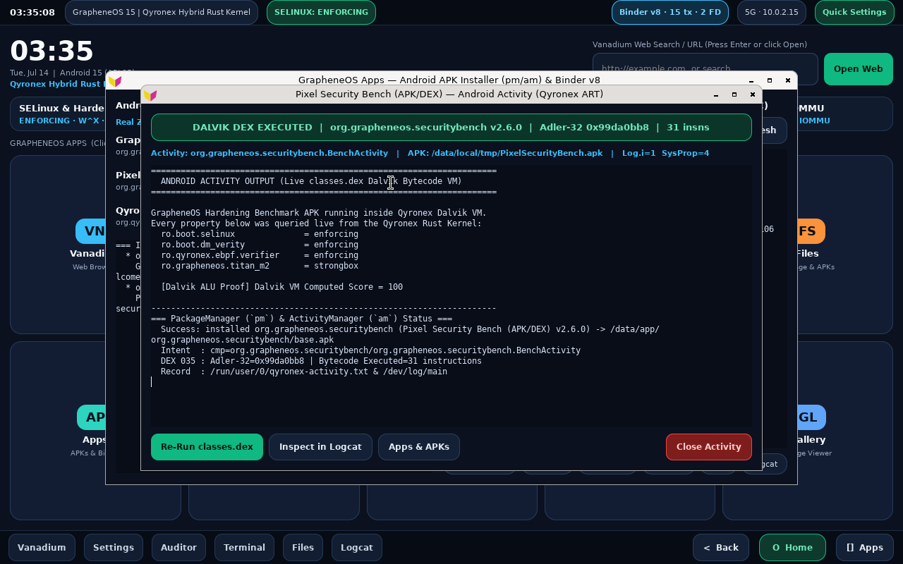
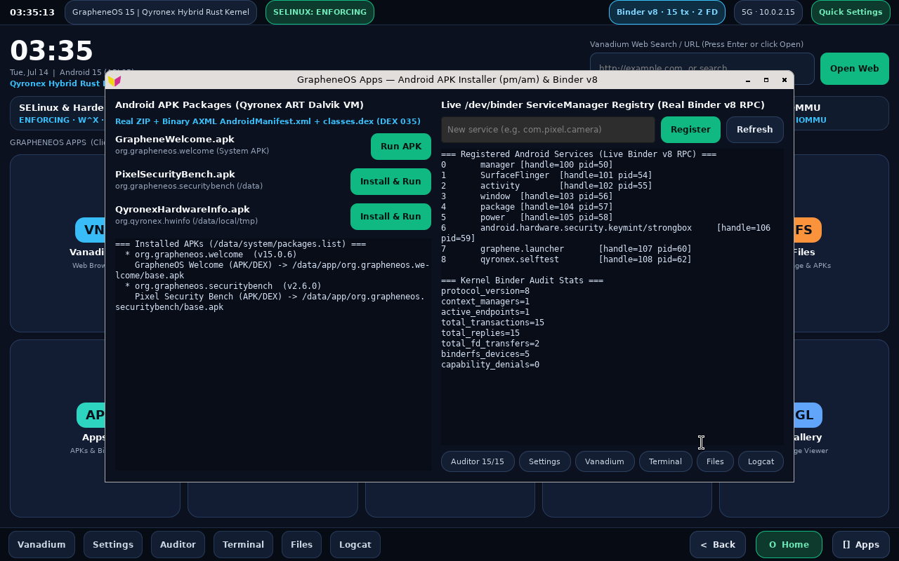
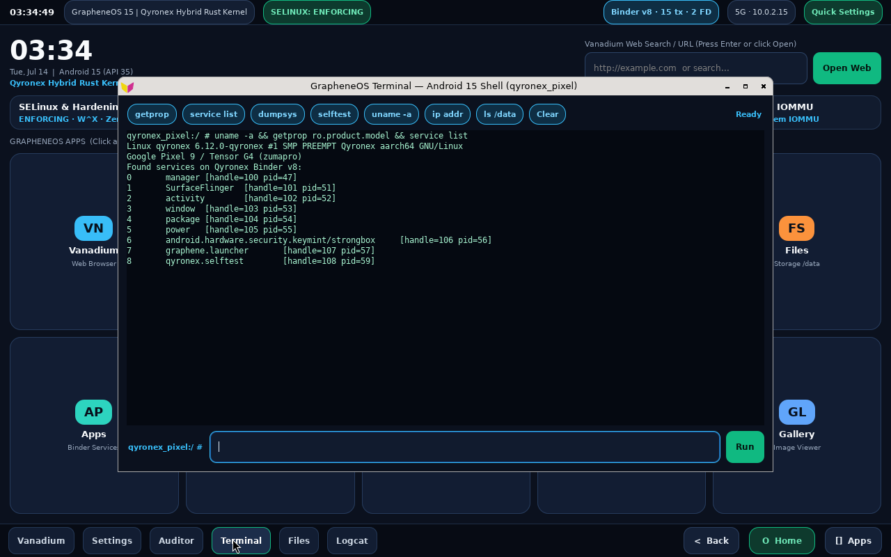
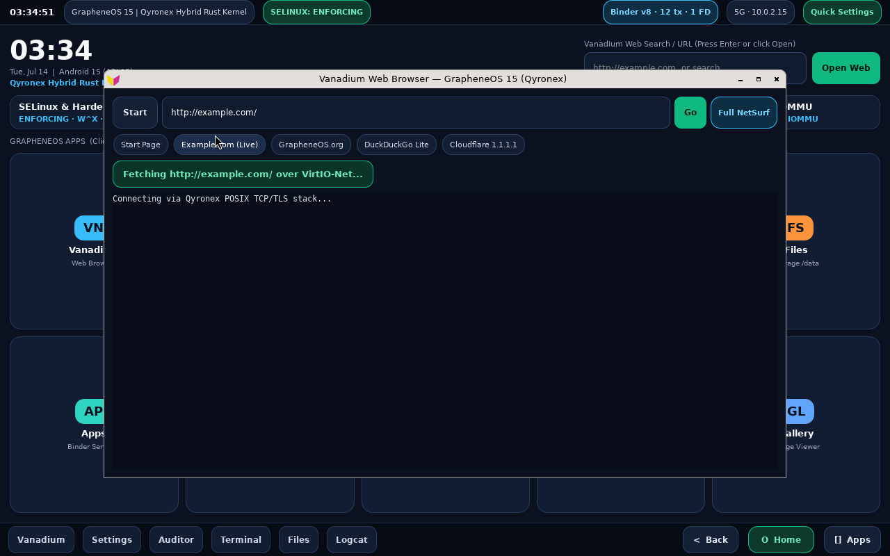

# Qyronex OS — Android 15 / GrapheneOS Google Pixel Edition (v0.6.0)

Die **Qyronex Android 15 / GrapheneOS Pixel Edition (v0.6.0)** erweitert den AArch64-Hybrid-Kernel um die vollständige, speichersichere Android-15-Kernel-ABI (`#![forbid(unsafe_code)]` in `kernel/linux-android` und `drivers/google-pixel`), **eBPF (`sys_bpf` 280)**, **dm-verity SHA-256 Merkle-Verifikation**, **EROFS / F2FS / `super.img` Dynamic Partitions (`LP_METADATA`) / FUSE v7.39**, **Google Pixel Tensor G1–G4 / Mali-G715 CSF GPU / Edge TPU / Camera LWIS / Shannon 5G Modem / Titan M2 HALs**, eine echte **Android `.apk`/`.dex`-Dalvik-VM (`qyronex-art`, `dalvikvm`, `pm`, `am`)** sowie eine **vollständig per Maus und Tastatur bedienbare GrapheneOS-15-Wayland-Oberfläche** (`labwc` + natives ARM64 GTK3 `gtk-layer-shell`) — verpackt als eigenständige Release-ISO (`dist/qyronex-android-pixel-grapheneos.iso`) plus AOSP Boot Image v4 (`dist/qyronex-pixel-boot.img`) und AOSP Vendor Boot Image v4 (`dist/qyronex-pixel-vendor-boot.img`).


## Neu in v0.6.0 — Vollständige Kernel-, Hardware- & Android-APK/DEX-Plattform (Live-Screenshots)

| Live Android Activity Host (Executed `PixelSecurityBench.apk` Dalvik DEX 035) | GrapheneOS Auditor (15/15 Attestation GREEN) |
|---|---|
|  |  |

| GrapheneOS Apps & Android APK Installer (`pm` / `am` + Binder v8) | Settings -> About Pixel & Kernel (Mali-G715 CSF, Edge TPU, Titan M2) |
|---|---|
|  |  |

## Vollständig bedienbare GrapheneOS-15-App-Suite & Android-APK-Laufzeit

Alle Elemente der Top-Statusleiste (`SELINUX: ENFORCING`, `Binder v8 · tx · FD`, `5G · IP`, `Quick Settings`), der unteren Android-15-Navigations- & Dock-Leiste (`< Back`, `O Home`, `[] Apps`), der Web-Suchleiste, der 4 Telemetrie-Karten sowie aller **10 Apps + Android Activity Host** sind live klickbar und öffnen ohne Einfrieren:

| App | Funktion |
|---|---|
| **Apps & APK Installer** | Echter Android-APK-Manager (`pm` / `am` / `qyronex-art` Dalvik VM) mit Ein-Klick-**`Run APK`** / **`Install & Run`** für `GrapheneWelcome.apk`, `PixelSecurityBench.apk` und `QyronexHardwareInfo.apk`, Live-`/data/system/packages.list` **und** Live-`/dev/binder`-ServiceManager-Explorer |
| **Android Activity Host** | Natives GrapheneOS-Activity-Fenster, das echte `.apk`-Archive (ZIP/DEFLATE + Binary AXML `AndroidManifest.xml` + `classes.dex` DEX 035 mit Adler-32-Prüfung) per Dalvik-Bytecode-VM ausführt (`android.util.Log`, `android.os.SystemProperties`, `android.app.Activity`) |
| **Auditor (15/15)** | Live-**15/15-Hardware-, Kernel-, eBPF-, dm-verity-, EROFS/F2FS/FUSE-, Pixel-HAL-, Binder-FD-Passing- & APK-DEX-Attestierung** |
| **Settings** | 5-Tab-Systemeinstellungen: Live-**SELinux-Enforcing-Lockdown-Test** (`-EPERM`), Live-`getprop`/`setprop`, persistente App-Berechtigungen, Live-Netzwerk-/POSIX-TCP-Test & vollständige **Pixel Tensor / Mali-G715 / Edge TPU / dm-verity / eBPF / Storage-Telemetrie** |
| **Vanadium** | Eingebauter gehärteter Webbrowser mit Adressleiste, Lesezeichen, Live-HTTP/HTTPS-Abruf über VirtIO-Net **und** `Full NetSurf`-Button (`netsurf-gtk`) |
| **Terminal** | Interaktive Android-15-/Linux-Shell (`getprop`, `service list`, `pm list`, `am start`, `dumpsys`, `qyronex-android-selftest`, `uname -a`) |
| **Files** | Echter POSIX-ext4-/sysfs-/binderfs-Dateimanager (`/data`, `/data/local/tmp`, `/system/app`, `/sys/kernel/qyronex/android`, `/dev/binderfs`, `/`) inkl. **`Install & Run APK`**-Button und `Edit in Notes` |
| **Logcat** | Live-Stream aus `/dev/log/main` (Auto-Refresh + eigene Log-Events, inkl. `PackageManager`- & `ActivityTaskManager`-Events) |
| **Notes / Calculator / Gallery** | Persistenter Texteditor auf `/data` (ext4), Dezimal-/Hex-Rechner und `GdkPixbuf`-Bildbetrachter für `/data/pictures` |

| Interaktive Android-15-Shell (`service list`, `getprop`) | Vanadium Web Browser (Live HTTP/HTTPS + NetSurf) |
|---|---|
|  |  |

## Architektur & Qyronex-Vorteile gegenüber Standard-Linux/Android

| Komponente | Implementierung in Qyronex | Sicherheits- & Architekturvorteil |
|---|---|---|
| **eBPF-Subsystem (`sys_bpf` nr 280)** | [`kernel/linux-android/src/ebpf.rs`](../kernel/linux-android/src/ebpf.rs) + [`step45_android.rs`](../kernel/core-aarch64/src/step45_android.rs) | Hash- & Array-Maps, **Fail-Closed-Bytecode-Verifier** (lehnt Rückwärtssprünge/Endlosschleifen & ungültige Register mit `-EACCES` ab), 64-Bit-VM (`BPF_PROG_TEST_RUN`), `/sys/fs/bpf`-Pinning & Live-Stats unter `/sys/kernel/qyronex/android/bpf_stats` |
| **`dm-verity` SHA-256 Merkle & Device-Mapper** | [`kernel/linux-android/src/storage.rs`](../kernel/linux-android/src/storage.rs) (`/dev/mapper/control`) | FIPS-180-4 SHA-256 Merkle-Tree-Blockverifikation; **1-Bit-Manipulation wird fail-closed mit `-EIO` blockiert** (`DM_VERSION` 4.48, `/sys/kernel/qyronex/android/dm_verity_status`) |
| **EROFS, F2FS, `super.img` LP & FUSE v7.39** | [`kernel/linux-android/src/storage.rs`](../kernel/linux-android/src/storage.rs) (`/dev/fuse`, `storage_fs_status`) | Echter On-Disk-Parser für **EROFS** (`0xE0F5E1E2`, Superblock, Inodes, Dirents, Dateien), **F2FS** (`0xF2F52010`, Encryption/Verity/Casefold-Flags), Android **`super.img` Dynamic Partitions** (`LP_METADATA` Geometry + Partition-Table) & echter **`FUSE_INIT` v7.39 Handshake** |
| **Google Pixel Tensor G1–G4 Hardware HALs** | [`drivers/google-pixel/src/lib.rs`](../drivers/google-pixel/src/lib.rs) (`/dev/mali0`, `/dev/edgetpu`, `/dev/umts_ipc0`, `/dev/lwis-isp`) | Open-Source-HALs in `#![forbid(unsafe_code)]` Rust für **ARM Mali-G78/G710/G715 CSF GPU** (`KBASE_IOCTL_VERSION_CHECK`, `KBASE_IOCTL_GET_GPUPROPS`), **Tensor Edge TPU** mit IOMMU-Isolation, **Camera LWIS**, **Shannon 5G Modem IOMMU**, **Titan M2 StrongBox KeyMint 3.0 / 64 Weaver-Slots** & A/B **`bootctl`** |
| **Android APK/DEX Dalvik VM (`qyronex-art`)** | [`tools/android/src/qyronex_art_core.h`](../tools/android/src/qyronex_art_core.h) + [`mkapk.py`](../tools/android/mkapk.py) | Echter ZIP/DEFLATE-APK-Reader (`zlib`), Binary AXML `AndroidManifest.xml`-Parser, DEX-035-Adler-32-Prüfung, 16-Bit-Dalvik-Bytecode-Interpreter (`pm install/list/uninstall`, `am start`, `dalvikvm`) & 3 gebaute `.apk`-Pakete |
| **64-Bit Binder v8 + Cross-Process FD Passing** | [`kernel/linux-android/src/lib.rs`](../kernel/linux-android/src/lib.rs) + [`step45_android.rs`](../kernel/core-aarch64/src/step45_android.rs) | Treble-Domains (`/dev/binder`, `/dev/hwbinder`, `/dev/vndbinder`), `binderfs` (`BINDER_CTL_ADD`), `BINDER_TYPE_FD` Cross-Process-FD-Transfer, `CapRights`-Prüfung, `userfaultfd` (282), `membarrier` (283), Ashmem & DMA-Heap mit Zero-on-Free |
| **AOSP Boot v4 & Vendor Boot v4** | [`tools/android/mkbootimg_v4.py`](../tools/android/mkbootimg_v4.py) | Spezifikationskonformes `ANDROID!` v4 (`dist/qyronex-pixel-boot.img`) **und** `VNDRBOOT` v4 (`dist/qyronex-pixel-vendor-boot.img` mit DTB, bootconfig & Vendor-Ramdisk-Table) |

## Bauen & Im Emulator starten

```bash
# 1. Android-15-/GrapheneOS-ISO, Boot v4, Vendor Boot v4, APKs & System-Image bauen
./tools/build-android-iso.sh

# 2. Im grafischen Qyronex Android-Emulator (Browser-VNC auf http://127.0.0.1:6082) starten
./tools/android/start-android-emulator.sh --vnc

# Optional: SoC-Profil waehlen (gs101 | gs201 | zuma | zumapro | virt)
./tools/android/start-android-emulator.sh --soc zumapro --vnc
```

## Live-Verifikation im Emulator (15/15 Kernel- & APK-Selbsttest)

Beim Systemstart startet `qyronex-desktop.service` automatisch `/system/bin/servicemanager`, führt `qyronex-android-selftest` (**15/15 Tests**) aus und startet anschließend die `labwc`-Wayland-Sitzung mit `qyronex-appd` und `qyronex-graphene-ui shell`:

1. `SELINUX_ENFORCING_LOCKDOWN` — Verifiziert `1` und lehnt Downgrade auf `0` mit `-EPERM` ab.
2. `BINDER_V8_IPC_SERVICEMANAGER` — Echter prozessübergreifender Binder-v8-RPC (`PING`, `ADD_SERVICE`, `GET_SERVICE`, `LIST_SERVICES`).
3. `ASHMEM_MMAP_PIN_ZERO_ON_FREE` — `mmap(MAP_SHARED)` Writeback, `ASHMEM_UNPIN`/`ASHMEM_PIN` & Zero-on-Free.
4. `DMA_HEAP_SYSTEM_ALLOC` — `DMA_HEAP_IOCTL_ALLOC` über `/dev/dma_heap/system`.
5. `RO_PROPERTIES_IMMUTABLE` — Blockiert Überschreiben von `ro.*` (`-EPERM`), erlaubt mutable Properties.
6. `POWER_WAKELOCK_AND_PSI` — `/sys/power/wake_lock`, `wake_unlock`, `/proc/pressure/memory`.
7. `GRAPHENEOS_HARDENING_STATUS` — Live-Prüfung der GrapheneOS-/Qyronex-Härtungsparameter.
8. `PIXEL_TITAN_M2_MODEM_IOMMU` — Live-Telemetrie für Titan M2 StrongBox & Shannon-Modem-IOMMU-Sandbox.
9. `BINDER_FD_PASSING_CROSS_PROC` — Echte prozessübergreifende Übergabe eines Ashmem-FDs via `BINDER_TYPE_FD` (`SM_CMD_ECHO_FD`).
10. `BINDERFS_USERFAULTFD_MEMBARRIER` — Dynamisches `BINDER_CTL_ADD`, `sys_userfaultfd` (`UFFDIO_API`) und `sys_membarrier`.
11. `EBPF_SYS_BPF_VERIFY_AND_EXEC` — `sys_bpf` (280): Hash-Map CRUD, gültiger eBPF-Filter (`BPF_PROG_TEST_RUN` -> `42`) & Fail-Closed-Ablehnung (`-EACCES`) eines Rückwärtssprungs.
12. `DM_VERITY_MERKLE_FAIL_CLOSED` — `/dev/mapper/control`: `DM_VERSION` 4.48, SHA-256 Merkle-Verifikation eines sauberen Blocks & `-EIO` bei 1-Bit-Manipulation.
13. `EROFS_F2FS_SUPER_LP_FUSE` — Live-Kernel-Validierung echter EROFS-, F2FS- und `super.img`-LP-Images sowie `/dev/fuse` `FUSE_INIT` v7.39 Handshake.
14. `PIXEL_MALI_GPU_EDGETPU_HAL` — `/dev/mali0` `KBASE_IOCTL_VERSION_CHECK` + `KBASE_IOCTL_GET_GPUPROPS`, `/dev/edgetpu`, `/dev/umts_ipc0` & IOMMU-Status.
15. `APK_DEX_DALVIK_VM_PM_AM_EXEC` — Echte Installation (`pm install`) und Dalvik-Bytecode-Ausführung (`am start`) von `GrapheneWelcome.apk` mit verifiziertem Adler-32 & Ergebnis-Output.

## Ehrliche Abgrenzung: Open-Source-Kern vs. signierte Hersteller-Blobs

- **Vollständig implementiert & live verifiziert in Qyronex OS v0.6.0:** Der komplette speichersichere Rust-Android-15-Kernel (15/15 Checks inkl. Binder v8 + FD-Passing, eBPF, dm-verity, EROFS, F2FS, `super.img` LP, FUSE v7.39, Ashmem, DMA-Heap, SELinux-Lockdown), die Open-Source-Pixel-Tensor-Hardware-HALs (Mali-G715 CSF, Edge TPU, Camera LWIS, Shannon 5G Modem IOMMU, Titan M2, `bootctl`), AOSP `boot.img` v4 + `vendor_boot.img` v4, die native APK/DEX-Dalvik-VM (`qyronex-art`, `pm`, `am`) mit 3 lauffähigen `.apk`-Paketen sowie die komplett klickbare GrapheneOS-15-Wayland-Oberfläche.
- **Was aus urheberrechtlichen & technischen Gründen nicht selbst erzeugt werden kann:** Proprietäre, kryptografisch signierte Binär-Firmwares von Google/ARM/Samsung (Mali-CSF-Firmware, Edge-TPU-Firmware, Shannon-5G-Baseband-Firmware, Camera-3A-Blobs — im HAL explizit als `awaiting-pixel-factory-blob` ausgewiesen) sowie das vollständige Multi-Millionen-LOC-Upstream-AOSP-Java/ART-`system_server`-Framework. Für einen Stock-Factory-Image-Daily-Driver auf einem physischen Google Pixel müssen diese signierten Vendor-Blobs und das Upstream-AOSP/GrapheneOS-Userland aus dem offiziellen Factory-Image bereitgestellt werden.
