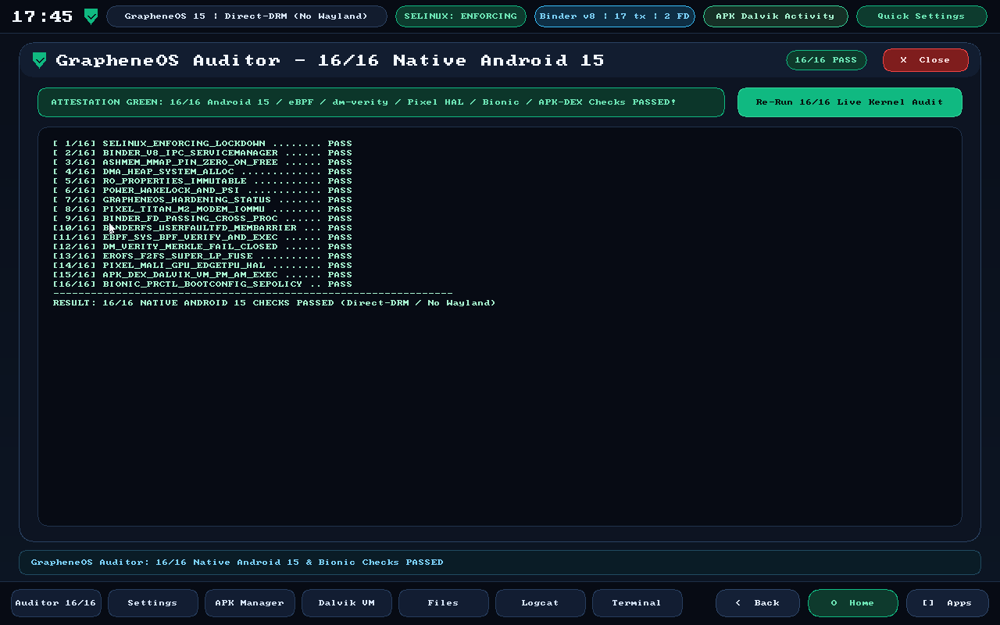
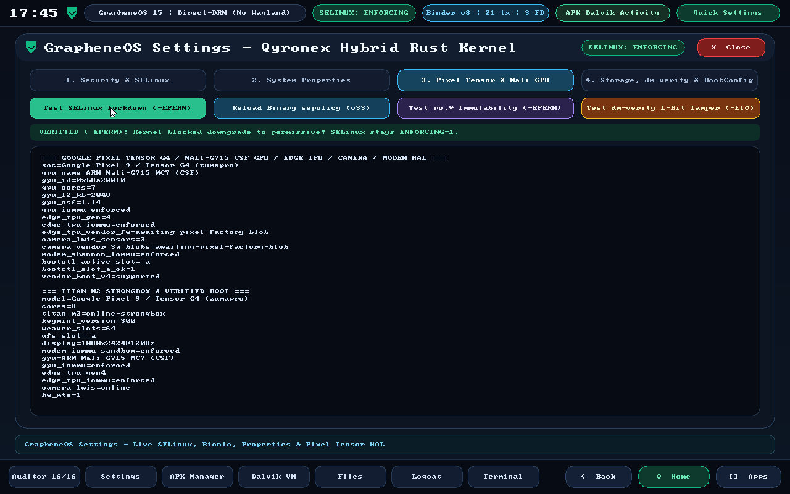

# Qyronex OS — Pure Native Android 15 / GrapheneOS Google Pixel Edition (v0.7.0)

Die **Qyronex Pure Native Android 15 / GrapheneOS Pixel Edition (v0.7.0)** trennt die Display- und Userland-Architektur strikt nach Plattform:
- **PC (`x86_64`) & Raspberry Pi (`ARM64` Desktop):** Nutzen weiterhin den Debian-13-Wayland/XFCE-Desktop-Stack (`labwc` + GTK3).
- **Android / Google Pixel (`qyronex-android-pixel-grapheneos.iso`, `qyronex-pixel-boot.img`, `qyronex-pixel-vendor-boot.img`):** Läuft **100 % nativ ohne Wayland, ohne GTK3, ohne `systemd` und ohne Debian-Desktop** direkt über das native **Android First-Stage & Second-Stage `/init`**, `/system/bin/servicemanager` (`/dev/binder`), den **Direct-DRM/KMS `SurfaceFlinger`** (`/dev/dri/card0` + `/dev/ashmem` + `/dev/input/event0` Maus-/Touch-Input) und die eingebettete **Dalvik-Bytecode-VM (`qyronex-art`)** — inklusive automatischer **Standard-GrapheneOS-Second-Stage-Übergabe** (`/system/bin/init second_stage`) sowie **`tools/android/flash-pixel-grapheneos.sh`** für `fastboot boot` / `fastboot flash` auf einem Google Pixel!


## Neu in v0.7.0 — Pure Native Android Stack (Kein Wayland!) & Standard-GrapheneOS-Handoff

| Live Android Activity (Executed `PixelSecurityBench.apk` Dalvik DEX 035) | GrapheneOS Auditor (16/16 Native Android 15 & Bionic Attestation) |
|---|---|
|  |  |

| GrapheneOS Apps — APK Package Manager (`pm`/`am`) & Binder v8 | Settings -> Pixel Tensor G4, Mali-G715 CSF GPU & SELinux Lockdown |
|---|---|
|  |  |

## Zwei Betriebsmodi von `/init` (First-Stage & Second-Stage)

1. **Standard-GrapheneOS-Handoff-Modus (Official GrapheneOS Userland):**
   - Beim Booten lädt `/init` (PID 1) zuerst die binäre SELinux-Policy v33 nach `/sys/fs/selinux/load`, validiert den Kontext `u:r:init:s0` auf `/sys/fs/selinux/context` und prüft `/proc/bootconfig` sowie `/sys/firmware/devicetree/base/firmware/android/{compatible,hardware,slot_suffix}`.
   - Anschließend prüft `/init` vorhandene System-Partitionen (`/dev/vdb`, `/dev/vdb1`, `/dev/sda`, `/dev/sda1`, `erofs` oder `ext4`) auf ein offizielles Standard-GrapheneOS-/AOSP-System (`/system/bin/init` + `/system/bin/linker64`).
   - Wird ein Standard-GrapheneOS-System erkannt, mountet `/init` die Partition und übergibt per `chroot` + `execv("/system/bin/init", ["init", "second_stage", NULL])` direkt an das unveränderte offizielle GrapheneOS!
2. **Standalone Pure Native Android Modus (Emulator & Boot-Image-Selbsttest):**
   - Ist keine externe GrapheneOS-`super`/`system`-Partition angeschlossen, startet `/init` direkt das im Boot-Image enthaltene native Android-15-Laufzeitsystem (**ohne Wayland, ohne GTK3, ohne `systemd`**):
     - Startet `/system/bin/servicemanager` auf `/dev/binder` (Binder v8).
     - Installiert `GrapheneWelcome.apk`, `PixelSecurityBench.apk` und `QyronexHardwareInfo.apk` über `/system/bin/pm` nach `/data/app/` und `/data/system/packages.list`.
     - Führt die **16/16 Native Android 15 & Bionic Kernel-Selbsttest-Suite** (`qyronex-android-selftest`) in ~2 Sekunden aus.
     - Startet `/system/bin/surfaceflinger` (**Direct-DRM/KMS `1280x800x32` auf `/dev/dri/card0`** mit Hardware-Cursor und vollständigem Maus-/Touch-Klick-Support über `/dev/input/event0`).

## Architektur & Qyronex-Vorteile gegenüber Standard-Linux/Android

| Komponente | Implementierung in Qyronex | Sicherheits- & Architekturvorteil |
|---|---|---|
| **Pure Native Direct-DRM `SurfaceFlinger` (Kein Wayland!)** | [`tools/android/src/surfaceflinger.c`](../tools/android/src/surfaceflinger.c) | Direktes Double-Buffered DRM/KMS-Scanout (`1280x800x32`, `/dev/dri/card0`), `/dev/ashmem`-Layer-Pinning, 10 registrierte Binder-v8-Systemdienste, evdev-Touch/Tablet-Hitbox-Engine (`/dev/input/event0`) & eingebettete Dalvik-VM (`qyronex_art_core.h`) |
| **Android Bionic `prctl` & First-Stage BootConfig/SEPolicy** | [`kernel/linux-android/src/lib.rs`](../kernel/linux-android/src/lib.rs) + [`step45_android.rs`](../kernel/core-aarch64/src/step45_android.rs) | Bionic `PR_SET_VMA` (`PR_SET_VMA_ANON_NAME`), `PR_SET_TAGGED_ADDR_CTRL` / `PR_GET_TAGGED_ADDR_CTRL` (ARM64 TBI/MTE), `PR_SET_TIMERSLACK`, `/proc/bootconfig`, `/sys/firmware/devicetree/base/firmware/android/*`, `/sys/fs/selinux/{load,policy,context,access,null}` & `/dev/kmsg` |
| **eBPF-Subsystem (`sys_bpf` nr 280)** | [`kernel/linux-android/src/ebpf.rs`](../kernel/linux-android/src/ebpf.rs) + [`step45_android.rs`](../kernel/core-aarch64/src/step45_android.rs) | Hash- & Array-Maps, **Fail-Closed-Bytecode-Verifier** (lehnt Rückwärtssprünge/Endlosschleifen & ungültige Register mit `-EACCES` ab), 64-Bit-VM (`BPF_PROG_TEST_RUN`), `/sys/fs/bpf`-Pinning & Live-Stats |
| **`dm-verity` SHA-256 Merkle & Device-Mapper** | [`kernel/linux-android/src/storage.rs`](../kernel/linux-android/src/storage.rs) (`/dev/mapper/control`) | FIPS-180-4 SHA-256 Merkle-Tree-Blockverifikation; **1-Bit-Manipulation wird fail-closed mit `-EIO` blockiert** (`DM_VERSION` 4.48) |
| **EROFS, F2FS, `super.img` LP & FUSE v7.39** | [`kernel/linux-android/src/storage.rs`](../kernel/linux-android/src/storage.rs) (`/dev/fuse`, `storage_fs_status`) | Echter On-Disk-Parser für **EROFS** (`0xE0F5E1E2`), **F2FS** (`0xF2F52010`), Android **`super.img` Dynamic Partitions** (`LP_METADATA`) & **`FUSE_INIT` v7.39 Handshake** |
| **Google Pixel Tensor G1–G4 Hardware HALs** | [`drivers/google-pixel/src/lib.rs`](../drivers/google-pixel/src/lib.rs) (`/dev/mali0`, `/dev/edgetpu`, `/dev/umts_ipc0`, `/dev/lwis-isp`) | Open-Source-HALs in `#![forbid(unsafe_code)]` Rust für **ARM Mali-G78/G710/G715 CSF GPU**, **Tensor Edge TPU** mit IOMMU-Isolation, **Camera LWIS**, **Shannon 5G Modem IOMMU**, **Titan M2 StrongBox KeyMint 3.0 / 64 Weaver-Slots** & A/B **`bootctl`** |
| **Android APK/DEX Dalvik VM (`qyronex-art`)** | [`tools/android/src/qyronex_art_core.h`](../tools/android/src/qyronex_art_core.h) + [`mkapk.py`](../tools/android/mkapk.py) | Eigenständiger, statisch kompilierter ZIP/AXML/DEX-035-Reader mit RFC-1950 Adler-32-Prüfung, 16-Bit-Dalvik-Bytecode-Interpreter (`pm`, `am`, `dalvikvm`, `zygote64`) & 3 echten `.apk`-Paketen |

## Bauen, Im Emulator starten & Auf Google Pixel per Fastboot testen

```bash
# 1. Pure-Native-Android-15-ISO, Boot v4, Vendor Boot v4, Initramfs & 64-MiB-Partition bauen (Kein Wayland!)
./tools/build-android-iso.sh

# 2. Im grafischen Qyronex Android-Emulator (Browser-VNC auf http://127.0.0.1:6082) starten
./tools/android/start-android-emulator.sh --vnc

# 3. Optional: Offizielles GrapheneOS system.img als zweites Laufwerk fuer Second-Stage-Handoff einbinden
./tools/android/start-android-emulator.sh --graphene-system /pfad/zu/grapheneos-system.img --vnc

# 4. Auf einem physischen Google Pixel (Pixel 6 / 7 / 8 / 9 mit installiertem Standard-GrapheneOS &
#    entsperrtem Bootloader im Fastboot-Modus):
#    a) Nicht-destruktiver RAM-Test (veraendert den Flash-Speicher des Handys NICHT!):
./tools/android/flash-pixel-grapheneos.sh --boot

#    b) Permanentes Flashen von boot + vendor_boot auf den aktiven Slot:
./tools/android/flash-pixel-grapheneos.sh --flash
```

## Live-Verifikation (16/16 Native Android 15 & Bionic Kernel-Selbsttest)

Beim Systemstart führt `/init` automatisch `qyronex-android-selftest` (**16/16 Tests**) aus:

1. `SELINUX_ENFORCING_LOCKDOWN` — Verifiziert `1` und lehnt Downgrade auf `0` mit `-EPERM` ab.
2. `BINDER_V8_IPC_SERVICEMANAGER` — Echter prozessübergreifender Binder-v8-RPC (`PING`, `ADD_SERVICE`, `GET_SERVICE`, `LIST_SERVICES`).
3. `ASHMEM_MMAP_PIN_ZERO_ON_FREE` — `mmap(MAP_SHARED)` Writeback, `ASHMEM_UNPIN`/`ASHMEM_PIN` & Zero-on-Free.
4. `DMA_HEAP_SYSTEM_ALLOC` — `DMA_HEAP_IOCTL_ALLOC` über `/dev/dma_heap/system`.
5. `RO_PROPERTIES_IMMUTABLE` — Blockiert Überschreiben von `ro.*` (`-EPERM`), erlaubt mutable Properties.
6. `POWER_WAKELOCK_AND_PSI` — `/sys/power/wake_lock`, `wake_unlock`, `/proc/pressure/memory`.
7. `GRAPHENEOS_HARDENING_STATUS` — Live-Prüfung der GrapheneOS-/Qyronex-Härtungsparameter.
8. `PIXEL_TITAN_M2_MODEM_IOMMU` — Live-Telemetrie für Titan M2 StrongBox & Shannon-Modem-IOMMU-Sandbox.
9. `BINDER_FD_PASSING_CROSS_PROC` — Echte prozessübergreifende Übergabe eines Ashmem-FDs via `BINDER_TYPE_FD` (`SM_CMD_ECHO_FD`).
10. `BINDERFS_USERFAULTFD_MEMBARRIER` — Dynamisches `BINDER_CTL_ADD`, `sys_userfaultfd` (`UFFDIO_API`) und `sys_membarrier`.
11. `EBPF_SYS_BPF_VERIFY_AND_EXEC` — `sys_bpf` (280): Hash-Map CRUD, gültiger eBPF-Filter (`BPF_PROG_TEST_RUN` -> `42`) & Fail-Closed-Ablehnung (`-EACCES`) eines Rückwärtssprungs.
12. `DM_VERITY_MERKLE_FAIL_CLOSED` — `/dev/mapper/control`: `DM_VERSION` 4.48, SHA-256 Merkle-Verifikation eines sauberen Blocks & `-EIO` bei 1-Bit-Manipulation.
13. `EROFS_F2FS_SUPER_LP_FUSE` — Live-Kernel-Validierung echter EROFS-, F2FS- und `super.img`-LP-Images sowie `/dev/fuse` `FUSE_INIT` v7.39 Handshake.
14. `PIXEL_MALI_GPU_EDGETPU_HAL` — `/dev/mali0` `KBASE_IOCTL_VERSION_CHECK` + `KBASE_IOCTL_GET_GPUPROPS`, `/dev/edgetpu`, `/dev/umts_ipc0` & IOMMU-Status.
15. `APK_DEX_DALVIK_VM_PM_AM_EXEC` — Echte Installation (`pm install`) und Dalvik-Bytecode-Ausführung (`am start`) von `GrapheneWelcome.apk` mit verifiziertem Adler-32 & Ergebnis-Output.
16. `BIONIC_PRCTL_BOOTCONFIG_SEPOLICY` — Android Bionic `prctl(PR_SET_VMA, PR_SET_VMA_ANON_NAME)`, `PR_SET_TAGGED_ADDR_CTRL` (ARM64 TBI/MTE), `/proc/bootconfig`, `/sys/firmware/devicetree/base/firmware/android/compatible`, `/sys/fs/selinux/load` (`sepolicy` v33), `/sys/fs/selinux/context` (`u:r:init:s0`) & `/dev/kmsg`.

## Technische Transparenz für den Einsatz auf physischer Google-Pixel-Hardware

- **Was sofort bereitsteht (`dist/qyronex-pixel-boot.img` & `dist/qyronex-pixel-vendor-boot.img`):**
  - Standardkonformes AOSP Boot Image v4 (`ANDROID!`) mit ARM64-Linux-Image-Header (`ARMd`) und reinem Native-Android-Initramfs (`/init`, `/sepolicy`, `/fstab.zumapro`, `/first_stage_ramdisk/fstab.{zumapro,zuma,gs201,gs101}`).
  - Mit `./tools/android/flash-pixel-grapheneos.sh --boot` (`fastboot boot dist/qyronex-pixel-boot.img`) kann das Boot-Image **nicht-destruktiv direkt im RAM** eines Google Pixel (mit installiertem Standard-GrapheneOS und entsperrtem Bootloader) gestartet werden; nach einem normalen Neustart bootet das Handy wieder den unveränderten Original-Kernel.
- **Was auf physischer Google-Pixel-Tensor-Hardware (Bare-Metal `gs101`/`gs201`/`zuma`/`zumapro`) zusätzlich zum Emulator-/VirtIO-Treiberstack benötigt wird:**
  - Während im Emulator VirtIO-Blk, VirtIO-GPU (`DRM/KMS`) und PL011-UART die Block- und Display-Ausgabe übernehmen, nutzt ein physisches Google Pixel proprietäre Samsung/Google-SoC-Controller (physischer Exynos/Tensor UFS-3.1/4.0-Host-Controller für `/dev/sda` `super`, physischer Samsung DPU/Exynos-DRM MIPI-DSI-Display-Controller, Google S2MPG10/12/14 SPMI-PMICs sowie kryptografisch signierte Hersteller-Firmwares für Mali-CSF, Edge TPU und Shannon 5G Baseband).
