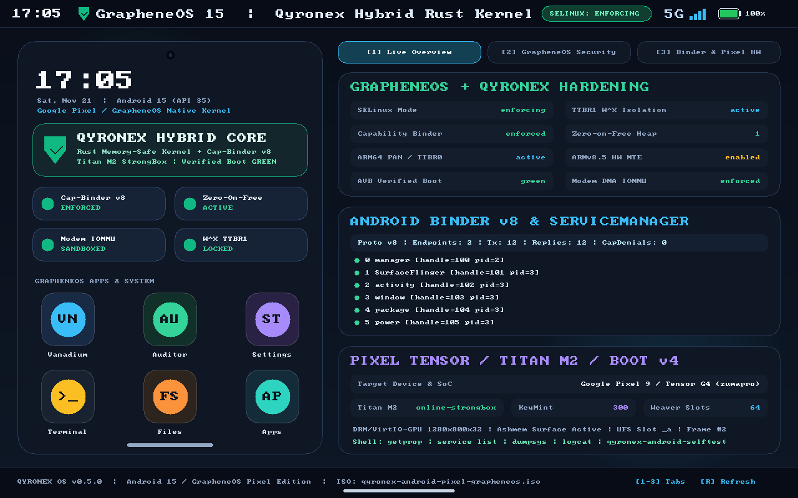

# Qyronex OS — Android 15 / GrapheneOS Google Pixel Edition

Die **Qyronex Android 15 / GrapheneOS Pixel Edition** erweitert den AArch64-Hybrid-Kernel um eine vollständige, speichersichere Android-15-Kernel-ABI (`#![forbid(unsafe_code)]` in den Subsystems- und Treiber-Crates), GrapheneOS-Härtung und eine Google-Pixel-Tensor-/Titan-M2-Treiberschicht — inklusive eigenständiger Release-ISO (`dist/qyronex-android-pixel-grapheneos.iso`) und Ein-Klick-Emulator.



## Architektur & Qyronex-Vorteile gegenüber Standard-Linux/Android

| Komponente | Implementierung in Qyronex | Sicherheits- & Architekturvorteil |
|---|---|---|
| **64-Bit Android Binder v8 IPC** | [`kernel/linux-android`](../kernel/linux-android/src/lib.rs) + [`step45_android.rs`](../kernel/core-aarch64/src/step45_android.rs) | Treble-Domain-Trennung (`/dev/binder`, `/dev/hwbinder`, `/dev/vndbinder`), **Qyronex `CapRights` Capability-Prüfung** auf jeder Transaktion, speichersicher in Rust (`#![forbid(unsafe_code)]`) |
| **Android Shared Memory & DMA-Heap** | `/dev/ashmem`, `/dev/dma_heap/system` | Echtes `mmap(MAP_SHARED)` mit Dirty-Writeback, Pin/Unpin und **GrapheneOS Zero-on-Free Sanitization** beim Schließen |
| **GrapheneOS Kernel-Lockdown** | `/sys/fs/selinux/*`, `/sys/kernel/qyronex/grapheneos/status` | **SELinux Enforcing nicht herabstufbar** (`write("0")` -> `-EPERM`), unveränderliche `ro.*`-System-Properties, W^X TTBR1-Isolation, HW PAN & ARMv8.5 MTE-Telemetrie |
| **Google Pixel Tensor & Titan M2** | [`drivers/google-pixel`](../drivers/google-pixel/src/lib.rs) | Tensor G1–G4 (`gs101`, `gs201`, `zuma`, `zumapro`), Titan M2 StrongBox KeyMint 3.0 & 64 Weaver-Slots, UFS A/B-Slot-Management, **IOMMU-gesandboxter Shannon-5G-Modem-DMA-Pfad** |
| **Android GKI Boot Image v4** | [`tools/android/mkbootimg_v4.py`](../tools/android/mkbootimg_v4.py) | Spezifikationskonformes AOSP `ANDROID!` v4-Boot-Image (`dist/qyronex-pixel-boot.img`) mit ARM64-Image-Header (`ARM\x64`) & Android-15-Initramfs |
| **Native ARM64 Android Userspace** | [`tools/android/src/`](../tools/android/src/) | `/system/bin/servicemanager`, `/system/bin/surfaceflinger` (VirtIO-GPU DRM `1280x800`), `/system/bin/android-init`, `getprop`, `setprop`, `service`, `dumpsys`, `logcat`, `qyronex-android-selftest` |

## Bauen & Im Emulator starten

```bash
# 1. Android-15-/GrapheneOS-ISO, GKI Boot Image v4 & System-Image bauen
./tools/build-android-iso.sh

# 2. Im grafischen Qyronex Android-Emulator (Browser-VNC + serielle Android-Shell) starten
./tools/android/start-android-emulator.sh --vnc

# Optional: SoC-Profil waehlen (gs101 | gs201 | zuma | zumapro | virt)
./tools/android/start-android-emulator.sh --soc zumapro --vnc
```

## Live-Verifikation im Emulator

Beim Boot startet `android-init` (PID 1) automatisch `/system/bin/servicemanager` (PID 2) und `/system/bin/surfaceflinger` (PID 3) und führt `qyronex-android-selftest` (8/8 Tests) aus:

1. `SELINUX_ENFORCING_LOCKDOWN` — Verifiziert `1` und lehnt Downgrade auf `0` mit `-EPERM` ab.
2. `BINDER_V8_IPC_SERVICEMANAGER` — Echter prozessübergreifender Binder-v8-RPC (`PING`, `ADD_SERVICE`, `GET_SERVICE`, `LIST_SERVICES`).
3. `ASHMEM_MMAP_PIN_ZERO_ON_FREE` — `mmap(MAP_SHARED)` Writeback, `ASHMEM_UNPIN`/`ASHMEM_PIN` & Zero-on-Free.
4. `DMA_HEAP_SYSTEM_ALLOC` — `DMA_HEAP_IOCTL_ALLOC` über `/dev/dma_heap/system`.
5. `RO_PROPERTIES_IMMUTABLE` — Blockiert Überschreiben von `ro.*` (`-EPERM`), erlaubt mutable Properties.
6. `POWER_WAKELOCK_AND_PSI` — `/sys/power/wake_lock`, `wake_unlock`, `/proc/pressure/memory`.
7. `GRAPHENEOS_HARDENING_STATUS` — Live-Prüfung der GrapheneOS-/Qyronex-Härtungsparameter.
8. `PIXEL_TITAN_M2_MODEM_IOMMU` — Live-Telemetrie für Titan M2 StrongBox & Shannon-Modem-IOMMU-Sandbox.

## Transparenz: Emulator vs. physisches Google Pixel (Daily Driver)

- **Sofort live lauffähig im QEMU-AArch64-Emulator:** Der komplette Qyronex Android-15-Kernel, Binder v8 IPC, Ashmem/DMA-Heap, SELinux-Lockdown, Properties, Wakelocks, PSI, `servicemanager`, `surfaceflinger` (VirtIO-GPU DRM-UI), CLI-Tools und das AOSP GKI Boot Image v4 (`qyronex-pixel-boot.img`).
- **Was für ein produktives Daily-Driver-GrapheneOS auf physischer Google-Pixel-Hardware noch zusätzlich erforderlich wäre:** Das vollständige AOSP-Userspace mit **ART/Java-Runtime & `system_server`** sowie die proprietären Google-Tensor-Vendor-Komponenten (`vendor_boot`, `vendor_dlkm`, Mali-GPU-Treiber, `f2fs`/`dm-verity`/`FUSE`/eBPF, geschlossene GXP/TPU/Kamera- und Shannon-5G-Modem-Firmware-Blobs).
