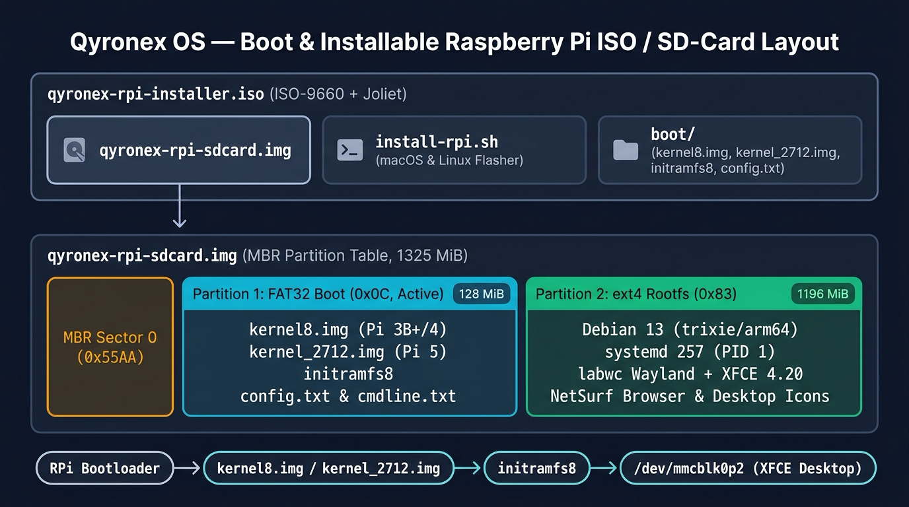

# Boot Protocol (x86_64 UEFI, AArch64 QEMU & Raspberry Pi 3B+/4/5)

Last updated: 2026-11-21

Qyronex Kernal enforces a strict trust boundary between firmware/bootloader and the privileged kernel. Firmware-internal structures are never adopted unchecked as kernel authority.

## 1. x86_64 UEFI Boot & `BootInfoV1` Handoff

1. **`BOOTX64.EFI` (`boot/uefi`)** normalizes the UEFI memory map (`MemoryRegionV1` array). Unknown firmware types are classified conservatively as reserved, and runtime firmware regions are never released to the frame allocator.
2. After `ExitBootServices`, the frozen normalized map is passed via `BootInfoV1` (`kernal-bootinfo`) into the high-half `kernal-core` (`CR3`), which brings up ACPI/MADT/IOAPIC/x2APIC SMP (1, 2, 4 vCPUs), detects Intel/AMD CPUID profiles, and scans the PCI/PCIe bus (`0xCF8`/`0xCFC`) to probe Ethernet NICs (`e1000`/`e1000e`).
3. Bootable media is built via `tools/build-x86-iso.sh` (`dist/qyronex-x86_64-uefi.iso` and `dist/qyronex-x86_64-uefi.img`).

## 2. AArch64 Boot: QEMU `virt` & Native Raspberry Pi (3B+ / 4B / 5)

- **QEMU `virt`:** Boots `kernal-core-aarch64` (`linker-aarch64.ld`, `0x4020_0000`) with `GICv3`, `PSCI`, `PL011` and `virtio-mmio` discovered from FDT.
- **Native Raspberry Pi 3B+ / 4B / 5 (`--features rpi-native`, `linker-rpi.ld`):**
  - Prepends a 64-byte **ARM64 Linux Image Header (`ARM\x64` magic)** at `0x0008_0000` (`kernel8.img` / `kernel_2712.img`).
  - Drops cleanly from `EL3` or `EL2` to `EL1h`, parks secondary cores until brought online, copies hardware DTBs located outside QEMU `virt` RAM (including page-0 DTBs) into `.bss` so page 0 remains unmapped, and selects **GIC-400 (`GICv2`)** on Pi 4B/5 or **BCM2836/2837 QA7 Local INTC** on Pi 3B+.
  - Queries the live VideoCore IV hardware mailbox (`0x3F00_B880`) over TTBR1-mapped MMIO and verifies real ARMv8 timer IRQ delivery (verified live on `qemu-system-aarch64 -M raspi3b` with official `bcm2710-rpi-3-b-plus.dtb`).
  - Bootable media (`dist/qyronex-rpi-installer.iso` & `dist/qyronex-rpi-sdcard.img`) includes official Raspberry Pi firmware (`bootcode.bin`, `start*.elf`, `fixup*.dat`), DTBs (`bcm2710`, `bcm2711`, `bcm2712`), `kernel8.img`, `kernel_2712.img`, `initramfs8`, `config.txt`, `cmdline.txt` and the Debian 13 ext4 rootfs.

See also the German documentation [docs/de/BOOT_PROTOKOLL.md](de/BOOT_PROTOKOLL.md).
