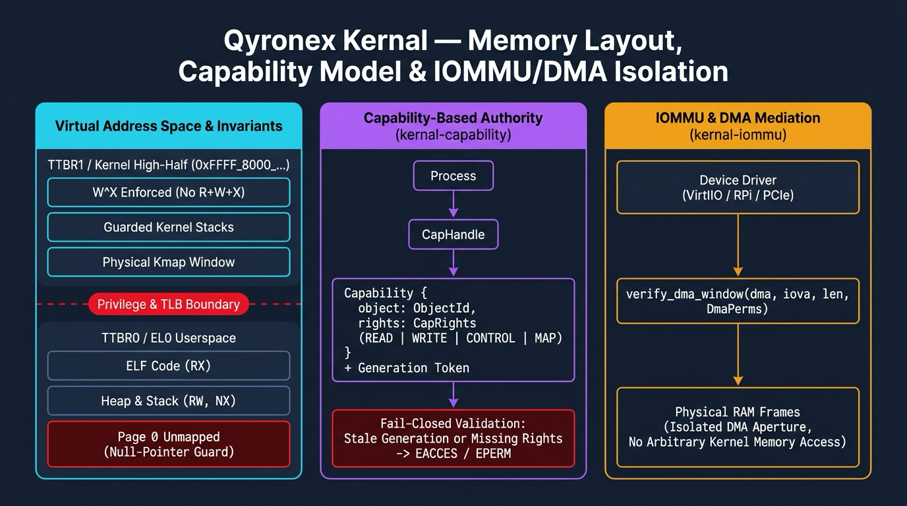

# Virtual Memory Layout, Capabilities & IOMMU/DMA Isolation

Last updated: 2026-11-21

Qyronex Kernal enforces strict separation between userspace, kernel space, and device DMA across both **AArch64** and **x86_64**.

## 1. Address-Space Separation

| Architecture | Userspace | Kernel High-Half | Hardware Protections |
|---|---|---|---|
| **AArch64 (QEMU `virt` / RPi)** | `TTBR0_EL1` (`0x0000_0000_...`) | `TTBR1_EL1` (`0xffff_ffff_8020_0000` / `0xffff_ffff_8008_0000`) | `PAN`, `W^X`, Null-Page Guard, Guarded Kernel Stacks |
| **x86_64 (Intel & AMD)** | Lower canonical half (`Ring 3`) | `0xffff_ffff_8020_0000` (`CR3`, separate `PT_LOAD`) | `NX`, `SMEP`, `SMAP`, Null-Page Guard, IST Guard Stacks |

## 2. Hard Invariants

1. **W^X:** No kernel or user mapping may be writable and executable simultaneously.
2. **Null-Page Guard:** Page `0` stays unmapped once kernel page tables are active (even on Raspberry Pi hardware where firmware places DTBs in low RAM, DTBs are copied into `.bss` prior to enabling MMU).
3. **Guarded Kernel & Clone Stacks:** Every bootstrap, secondary, worker, and clone stack is preceded by an unmapped guard page.
4. **Explicit Usercopy:** All kernel accesses to user memory go through bounded, direction-checked usercopy paths.
5. **Non-Executable Device MMIO:** All MMIO apertures (`Device-nGnRnE` on AArch64, `Uncached` on x86_64) are mapped `NX`.

## 3. Capability Authority & IOMMU/DMA Enforcement

- **Capabilities (`kernal-capability`):** Kernel objects and hardware operations require explicit `Capability { object: ObjectId, rights: CapRights }` handles plus generation validation (`fail-closed` with `EACCES`/`EPERM`).
- **IOMMU / DMA (`kernal-iommu`):** Drivers (`VirtIO`, `PCIe`, `Raspberry Pi 3B+/4/5`) validate every DMA transfer against `DmaMapping` windows and `DmaPerms` via `verify_dma_window`.

See also the German documentation [docs/de/SPEICHERLAYOUT.md](de/SPEICHERLAYOUT.md).
