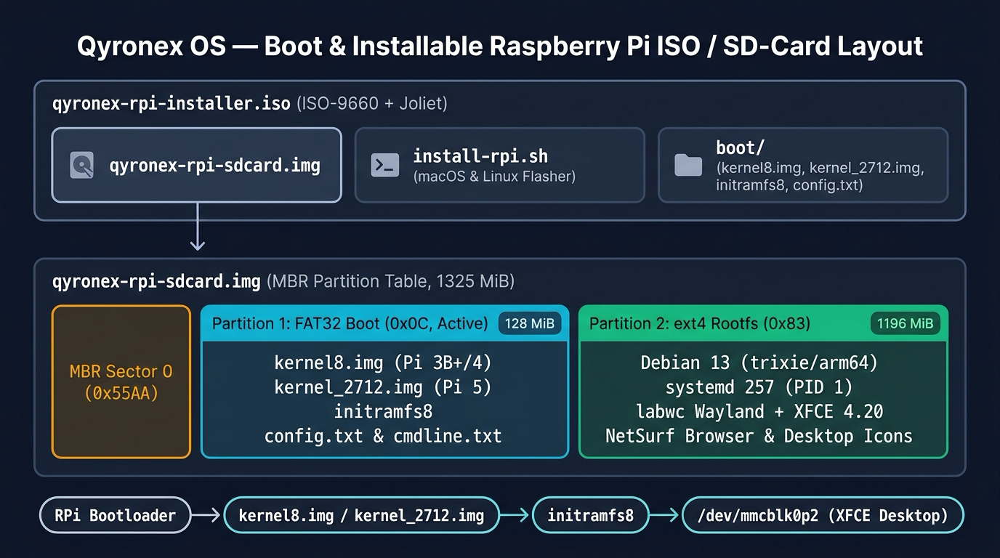

# Boot-Protokoll (x86_64 UEFI, AArch64 QEMU & Raspberry Pi)

Stand: 21.11.2026

Das Boot-Protokoll definiert die strikte Vertrauensgrenze zwischen Firmware/Bootloader und dem privilegierten Kernel. Firmware-interne Strukturen werden **nicht ungeprüft** als Autorität übernommen.

---

## 1. x86_64 UEFI-Boot & `BootInfoV1` Handoff

1. **`BOOTX64.EFI` (`boot/uefi`):** Initialisiert Grafik/Serial, liest die UEFI Memory Map und normalisiert unbekannte Firmware-Typen konservativ als `Reserved`.
2. **`ExitBootServices`:** Nach dem Verlassen der UEFI Boot Services wird die Speicherkarte eingefroren und als versionierte `kernal-bootinfo` (`BootInfoV1`) übergeben.
3. **Kernel-High-Half & SMP (`kernel/core`):**
   - Wechsel auf eigene `CR3`-Seitentabellen mit Guard-Stacks und Null-Page-Schutz.
   - Streaming-ACPI-Parsing (`RSDP` -> `XSDT`/`RSDT` -> `MADT`, `FADT`) für IOAPICs, x2APIC und TSC-Kalibrierung.
   - Deterministischer SMP-Bringup der Application Processors (1, 2 und 4 vCPUs) und CPUID-Erkennung (`GenuineIntel` / `AuthenticAMD`).

---

## 2. AArch64 Boot: QEMU `virt` & Raspberry Pi (3B+ / 4 / 5)

- **FDT-Validierung (`firmware/fdt-aarch64`):** Der Flattened Device Tree (DTB) wird strikt geparst; Adressbereiche werden auf Überläufe, Nullgrößen und Überlappungen geprüft.
- **QEMU `virt`:** Entdeckt `arm,gic-v3`, `arm,pl011`, `arm,pl031`, `pci-host-ecam-generic`, `virtio,mmio` und `/chosen` (`bootargs`, `rng-seed`).
- **Raspberry Pi Hardware-Boot (via `qyronex-rpi-sdcard.img`):**
  1. Die VideoCore-Firmware lädt `config.txt` (`arm_64bit=1`, `enable_uart=1`) und `initramfs8`.
  2. Auf **Pi 3B+ (`BCM2837B0`)** und **Pi 4B (`BCM2711`)** startet `kernel8.img`, auf **Pi 5 (`BCM2712`)** startet `kernel_2712.img`.
  3. Nach Initramfs-Mount übernimmt `systemd` (`/sbin/init`) auf `/dev/mmcblk0p2` (`ext4`) bzw. `/dev/vda1` in QEMU.

---

## 3. Sicherheitsinvarianten beim Boot

- Keine Nutzung ungeprüfter Firmware-Pointer nach dem Handoff.
- Kein implizites Freigeben von Runtime-Firmware-Speicher.
- Keine stillen Ganzzahlüberläufe bei `base + size` oder VideoCore-Bus-Übersetzung (`0x7E00_0000 -> 0x3F00_0000` / `0xFE00_0000`).
- Frühestmöglicher Wechsel in eigene Seitentabellen (`TTBR0`/`TTBR1` bzw. `CR3`).

Siehe auch [`../BOOT_PROTOCOL.md`](../BOOT_PROTOCOL.md).
