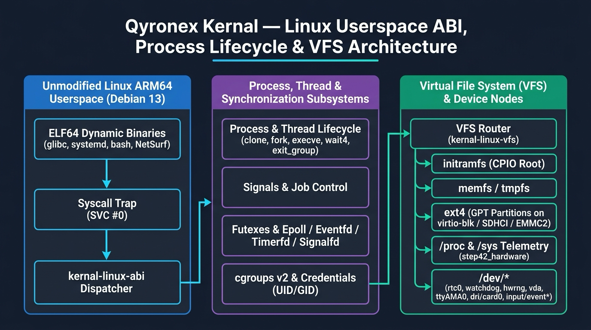

# Linux-Userspace-ABI, VFS & Debian-13-Kompatibilität

Stand: 21.11.2026

Qyronex Kernal führt ein **unverändertes Debian 13 (trixie/arm64) Userspace** auf seiner eigenen Rust-Kernelarchitektur aus — ohne Linux-Kernelcode zu kopieren und ohne Linux-Kernelmodule (`.ko`) zu unterstützen.

---

## 1. Architektur der Linux-ABI-Schicht

- **Syscall-Trap (`SVC #0` auf AArch64):** Alle Aufrufe von `glibc`, `systemd`, `udev`, `dbus`, `labwc`, `XFCE` und `NetSurf` laufen über den `kernal-linux-abi`-Dispatcher.
- **Prozess-, Thread- & Event-Subsysteme:**
  - `clone` / `fork` / `vfork` / `execve` / `wait4` / `exit_group` inklusive Job-Control und Signalzustellung (`sigaction`, `rt_sigreturn`, `signalfd`).
  - Moderne Deskriptor-APIs: `futex`, `epoll`, `eventfd`, `timerfd`, `memfd_create`, `pipe2`, `pidfd`, sowie `cgroups v2` und `UID`/`GID`-Credentials.
- **Fail-Closed-Vertrag:** Nicht implementierte Syscalls oder Ioctls liefern sauber `ENOSYS` / `ENOTTY` zurück, statt stillen Erfolg vorzutäuschen.

---

## 2. Virtuelles Dateisystem (VFS) & Gerätepfade

Der VFS-Router (`kernal-linux-vfs` + `step33_ext4_vfs` + `step42_hardware`) vereint:

- **`initramfs` (CPIO)** als frühes Root-Dateisystem beim Boot;
- **`memfs` / `tmpfs`** für `/run`, `/tmp` und flüchtige IPC-Sockets;
- **`ext4` auf GPT/MBR-Partitionen** über `virtio-blk` (QEMU) bzw. `SDHCI`/`EMMC2` (Raspberry Pi);
- **`/proc` & `/sys` Telemetrie:** Prozessstatus, Mounts, CPU-Online-Masken sowie Hardware-Treiberknoten (`/sys/bus/platform/drivers/bcm2837/*`, `bcm2711/*`, `bcm2712/*`, `/sys/bus/pci/drivers/pcie_nic/status`);
- **`/dev/*` Geräteknoten:** `/dev/vda*`, `/dev/rtc0`, `/dev/watchdog`, `/dev/hwrng`, `/dev/pts/*`, `/dev/dri/card0`, `/dev/input/event*`.

---

## 3. Verifizierter Debian-13-Meilenstein

- `systemd 257` bootet als `PID 1` bis `multi-user.target` und startet `udevd`, `journald`, `dbus` und `qyronex-desktop.service`.
- Vollständige Desktop-Session mit `labwc` (Wayland), `XFCE 4.20`, `xfce4-terminal`, `NetSurf` Webbrowser und `qyronex-filemanager`.

Siehe auch [`../../DEBIAN_13_COMPATIBILITY_ROADMAP.md`](../../DEBIAN_13_COMPATIBILITY_ROADMAP.md).
