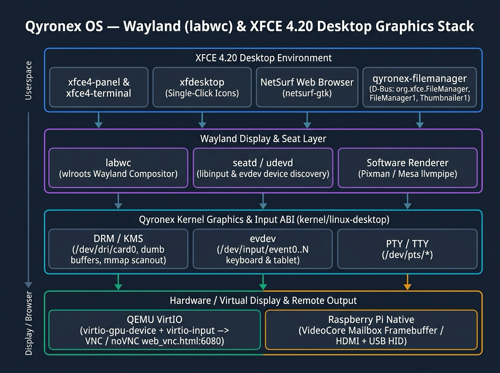

# Grafik-, Eingabe- & Wayland/XFCE-Desktop-Stack

Stand: 21.11.2026

Qyronex OS trennt den **grafischen Desktop (Userspace)** strikt vom **Kernel**: `labwc`, `XFCE 4.20` und `NetSurf` sind unveränderte Debian-13-Programme, die über standardisierte Linux-DRM/KMS- und `evdev`-Schnittstellen mit dem Kernel kommunizieren.

---

## 1. Schichtenmodell vom Desktop bis zur Hardware

1. **XFCE 4.20 Desktop-Umgebung (`Debian 13` Userspace):**
   - `xfce4-panel`, `xfce4-terminal`, `xfdesktop` (Desktop-Symbole mit Einzelklick-Aktivierung) und `netsurf-gtk` (Webbrowser).
   - **`qyronex-filemanager` (D-Bus-Dienst):** Implementiert `org.xfce.FileManager`, `org.freedesktop.FileManager1`, `org.xfce.Trash`, `org.xfce.Thunar` und `org.freedesktop.thumbnails.Thumbnailer1`, sodass Desktop-Icons, Papierkorb, Dateidialoge und Browser-Start direkt funktionieren.
2. **Wayland-Compositor & Seat-Verwaltung:**
   - `labwc` (`wlroots`-basierter Wayland-Compositor) übernimmt Fensterverwaltung, Cursor und XWayland-Unterstützung.
   - `udevd` und `seatd` erkennen Eingabe- und Grafikgeräte anhand der Kernel-`udev`-Tags (`/dev/dri/card0`, `/dev/input/event*`).
3. **Kernel-Grafik- & Eingabe-ABI (`kernel/linux-desktop`):**
   - **DRM / KMS (`/dev/dri/card0`):** Dumb-Buffer-Allokation, `mmap`-Framebuffer-Export und Atomic/Mode-Set-Ioctls.
   - **`evdev` (`/dev/input/event0..N`):** Ereigniswarteschlangen für Tastatur und absolute Tablet-/Maus-Koordinaten (`ABS_X`/`ABS_Y`).
   - **PTY / TTY (`/dev/pts/*`):** Vollständige Pseudoterminals für `xfce4-terminal` und Login-Shells.
4. **Hardware- & QEMU-Ausgabe:**
   - **In QEMU:** `virtio-gpu-device` + `virtio-input` (Keyboard & Tablet), dargestellt über VNC (`5900`) und den integrierten Browser-Viewer (`web_vnc.html` auf Port `6080`).
   - **Auf dem Raspberry Pi:** VideoCore Mailbox Framebuffer (`1920x1080x32bpp`) / HDMI sowie USB-HID über DWC2 (`Pi 3B+`), VL805 (`Pi 4B`) oder RP1 Dual xHCI (`Pi 5`).
