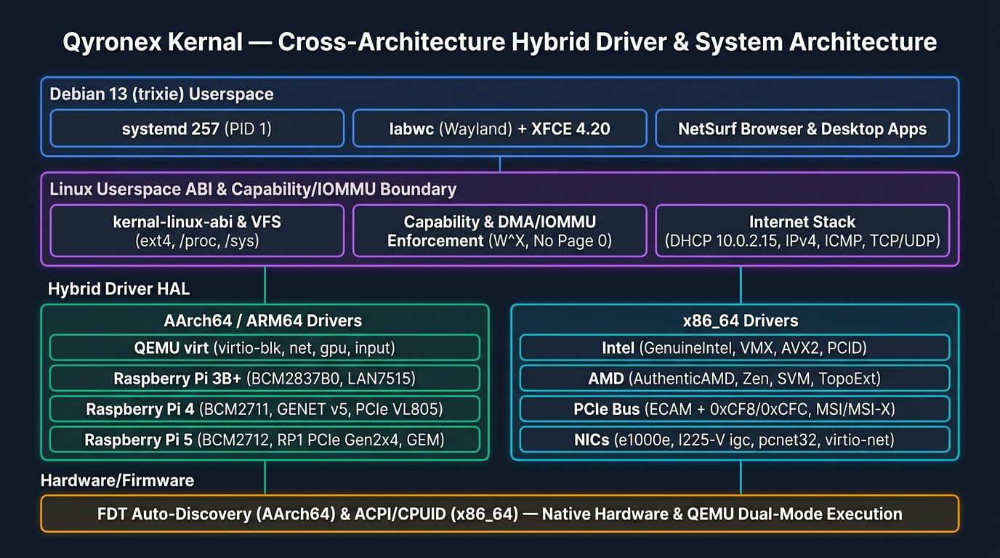
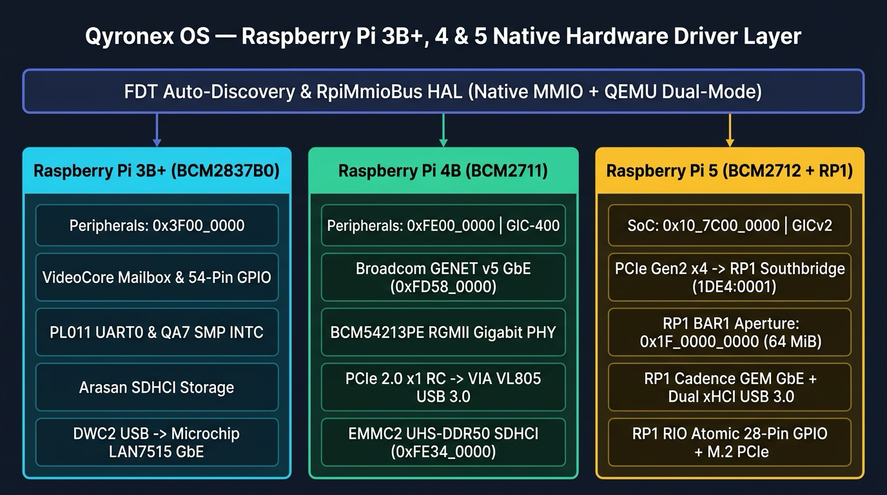
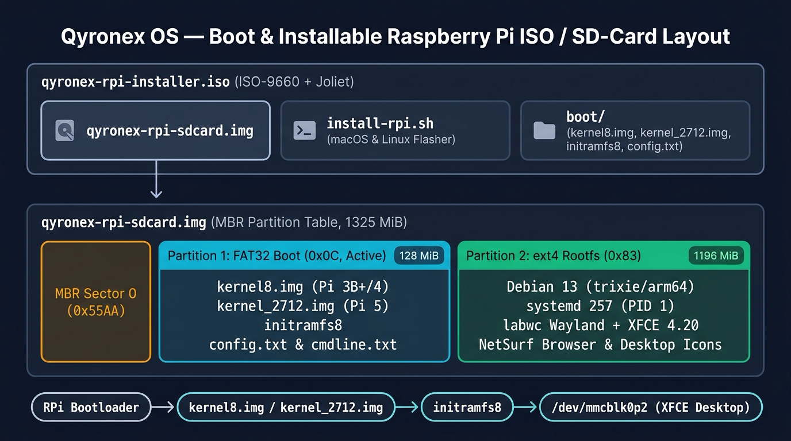

# Qyronex Kernal — Hardware-, Treiber- & ISO-Architektur

Stand: 21.11.2026

Dieses Dokument erklärt die **Hybrid-Kernel-Treiberschicht** von Qyronex Kernal über **x86_64** und **AArch64 (QEMU + Raspberry Pi 3B+ / 4 / 5)** sowie den Aufbau der **installierbaren Raspberry-Pi-ISO**.

---

## 1. Gesamtbild: Cross-Architektur Hybrid-Treiberschicht

Der Kern bleibt als kleiner, Capability- und IOMMU-gesicherter Hybrid-Kernel unverändert:

1. **Userspace (Debian 13 / trixie):** `systemd 257` als PID 1, `labwc` (Wayland-Compositor), `XFCE 4.20`, `NetSurf` Webbrowser sowie `qyronex-filemanager` für klickbare Desktop-Icons.
2. **Linux-Userspace-ABI & Capability-/IOMMU-Grenze:** `kernal-linux-abi`, VFS (`initramfs`, `memfs`, `ext4`), `/proc`, `/sys`, sowie der integrierte Netzwerk-/Internet-Stack (`InternetEndpointState`: DHCP `10.0.2.15/24`, IPv4, ARP, ICMP, TCP/UDP).
3. **Hybrid-Treiber-HAL (`MmioBus` / `PciConfigBus` / FDT / CPUID):** Alle Gerätetreiber prüfen Capabilities (`CapRights`), Generation-Tokens und IOMMU/DMA-Grenzen (`DmaMapping`). Dadurch läuft derselbe Kernel deterministisch in **QEMU** und auf nativen Registerlayouts.

---

## 2. x86_64: Intel & AMD Prozessoren, PCIe & Ethernet/Internet

### 2.1 Intel- & AMD-Prozessorerkennung (`kernel/arch-x86_64/src/lib.rs`)
* **Vendor-Erkennung (`CpuVendor`):** Dekodiert `CPUID(0)` in `GenuineIntel`, `AuthenticAMD` oder `Unknown`.
* **Family/Model/Stepping (`CpuFamilyModel`):** Dekodiert `CPUID(1).EAX` inklusive Extended Family & Extended Model (z. B. Intel Core/Xeon Family `0x06`, AMD Zen Family `0x19`).
* **Architektur-Features (`ProcessorProfile`):**
  * **Intel:** `VMX` (VT-x), `AVX2`, `AES-NI`, `PCID`, `INVPCID`, `RDRAND`, `RDSEED`, `SMEP`, `SMAP`, `x2APIC`.
  * **AMD:** `SVM` (AMD-V), `TopoExt`, `SSE4A`, `ABM/LZCNT`, `SYSCALL/SYSRET`, `1GiB Pages` (`PDPE1GB`), Invariant TSC und Adressbreiten (`0x8000_0008`).
* **QEMU-Boot-Nachweis (`kernel/core/src/freestanding.rs`):** UEFI-Boot, ACPI, IOAPIC, SMP-Bringup (1, 2 und 4 vCPUs) und Ausgabe des erkannten `ProcessorProfile` auf `COM1`.

### 2.2 PCIe & Netzwerk / Internet (`drivers/pci/src/lib.rs`, `kernel/linux-hardware/src/nic.rs`)
* **Konfigurationszugriff:** Unterstützt sowohl 64-Bit **PCIe ECAM** (`EcamWindow`) als auch **x86 Legacy Port-I/O** (`0xCF8` `CONFIG_ADDRESS` / `0xCFC` `CONFIG_DATA` via `legacy_io_config_address`).
* **Capabilities:** Parst **PCIe Capability (`0x10`)** (`PcieGen` Gen1 2.5 GT/s bis Gen5 32.0 GT/s, Lane-Breite `x1..x32`, `dll_link_active`), **MSI (`0x05`)** und **MSI-X (`0x11`)**.
* **Unterstützte NIC-Profile (`PciNicModel`):**
  * Intel `e1000` (`8086:100E`), `e1000e` (`8086:10D3`), `I210` (`8086:1533`), `I225-V` (`8086:15F3`, 2,5 GbE)
  * AMD `PCnet-PCI` (`1022:2000`)
  * Realtek `RTL8168` (`10EC:8168`)
  * VirtIO-Net PCI (`1AF4:1000` / `1AF4:1041`)
  * Raspberry Pi `LAN7515` (Pi 3B+), `BCM2711 GENET v5` (Pi 4B) & `RP1 Cadence GEM` (Pi 5)

---

## 3. Raspberry Pi 3B+, Raspberry Pi 4 & Raspberry Pi 5 Treiber-Stack

* **FDT Auto-Discovery (`firmware/fdt-aarch64/src/lib.rs`):** Erkennt automatisch QEMU `virt` sowie `brcm,bcm2837` (Pi 3B+), `brcm,bcm2711` (Pi 4B) und `brcm,bcm2712` / `raspberrypi,rp1` (Pi 5) und übersetzt VideoCore-Bus-Adressen (`0x7E00_0000`) auf die jeweiligen ARM-Basisadressen.
* **Raspberry Pi 3B+ (`drivers/rpi3b-plus/src/lib.rs`):** `0x3F00_0000` Peripheriebasis, VideoCore IV Mailbox, 54-Pin GPIO, PL011 UART0 & Mini-UART1, ARMCTRL + QA7 SMP-INTC, Arasan SDHCI, DWC2 USB 2.0 + Microchip `LAN7515` Gigabit Ethernet.
* **Raspberry Pi 4B (`drivers/rpi3b-plus/src/rpi4_bcm2711.rs`):** Low-Peripheral `0xFE00_0000`, GIC-400 (`0xFF84_1000`), Broadcom `GENET v5` Gigabit Ethernet (`0xFD58_0000`) + `BCM54213PE` PHY, `BCM2711` PCIe 2.0 x1 Root Complex (`0xFD50_0000` -> VIA `VL805` USB 3.0 xHCI `1106:3483`) und `EMMC2` SDHCI (`0xFE34_0000`).
* **Raspberry Pi 5 (`drivers/rpi3b-plus/src/rpi5_bcm2712.rs`):** 36-Bit SoC `0x10_7C00_0000`, GIC (`0x10_7FFF_9000`), PCIe Gen2 x4 Root Complex (`0x10_0012_0000`) zur **Raspberry Pi `RP1` Southbridge** (`1DE4:0001`, 64 MiB BAR1 bei `0x1F_0000_0000`) mit `RP1` Cadence `GEM` Gigabit Ethernet, dualem `DesignWare xHCI` USB 3.0 und atomarem `RIO` 28-Pin GPIO.

---

## 4. Installierbare Raspberry-Pi-ISO & SD-Karten-Layout

Über `tools/build-rpi-iso.sh` werden zwei direkt nutzbare Artefakte erzeugt:

1. **`dist/qyronex-rpi-sdcard.img` (MBR, 1325 MiB):**
   * **Partition 1 (`FAT32 LBA`, 128 MiB, aktiv):** `kernel8.img` (Pi 3B+/4), `kernel_2712.img` (Pi 5), `initramfs8`, `config.txt` (`arm_64bit=1`) und `cmdline.txt` (`root=/dev/mmcblk0p2`).
   * **Partition 2 (`ext4`, 1196 MiB):** komplettes Debian-13-Desktop-Rootfs (systemd 257, labwc, XFCE 4.20, NetSurf).
2. **`dist/qyronex-rpi-installer.iso` (ISO-9660 + Joliet):**
   * Enthält `qyronex-rpi-sdcard.img`, `boot/*`, `install-rpi.sh` (interaktiver Flasher für macOS & Linux) und `README-INSTALL.txt`.
