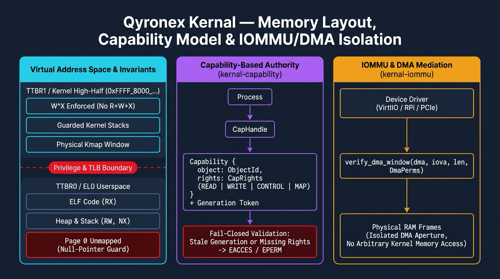

# Virtuelles Speicherlayout, Capabilities & IOMMU/DMA-Isolation

Stand: 21.11.2026

Qyronex Kernal trennt User- und Kerneladressräume sowie Geräte-DMA strikt und behandelt Speicherschutz nicht als nachträgliche Härtung, sondern als unveränderlichen Architekturvertrag.

---

## 1. Virtuelle Adressraum-Trennung (`TTBR0`/`TTBR1` & `CR3`)

- **AArch64:**
  - `TTBR0_EL1` bildet den **EL0-Userspace** (`0x0000_0000_0000_0000` bis `0x0000_FFFF_FFFF_FFFF`) ab.
  - `TTBR1_EL1` bildet den **EL1-Kernelraum** (`0xFFFF_0000_0000_0000` aufwärts) ab.
  - Hardware-**PAN** (*Privileged Access Never*) verhindert, dass Kernelcode versehentlich direkt auf Userspace-Seiten zugreift; jeder Zugriff muss explizit über die kontrollierten `usercopy`-Pfade laufen.
- **x86_64:**
  - Der Userspace liegt im unteren kanonischen Adressraum (`Ring 3`, standardmäßig `NX` auf Daten/Stack).
  - Das Kernelimage läuft im **High-Half** (`0xFFFF_FFFF_8020_0000` / UEFI-Handoff-Layout) mit getrennten `PT_LOAD`-Segmenten (`R-X` Text, `R--` Rodata, `RW-` Data/BSS).
  - **SMEP** & **SMAP** sowie `NX` (`IA32_EFER.NXE`) werden beim Start erzwungen.

---

## 2. Harte Speicherinvarianten

1. **W^X (*Write XOR Execute*):** Keine Seite darf gleichzeitig schreibbar und ausführbar sein.
2. **Nullseiten-Schutz:** Seite `0` bleibt nach Installation der Kernel-Seitentabellen dauerhaft ungemappt (`Null-Pointer Guard`).
3. **Guard Pages:** Kernel-Stacks, Exception-Stacks (IST) und Thread-Stacks besitzen ungemappte Schutzseiten gegen Stack-Überläufe.
4. **Expliziter Usercopy:** Jeder Copy-In/Copy-Out prüft Adressbereich, Ausrichtung, Kanonizität und Zugriffsrichtung.
5. **MMIO-Isolation:** Gerätespeicher (`Device-nGnRnE` auf AArch64 bzw. `UC` auf x86_64) wird niemals ausführbar gemappt.

---

## 3. Capability-Autoritätsmodell (`kernal-capability`)

Anstelle impliziter globaler Root-Autorität innerhalb des Kernels erfordert jede Objekt- und Geräteoperation ein gültiges Capability-Handle:

- `Capability { object: ObjectId, rights: CapRights }` (`READ`, `WRITE`, `CONTROL`, `MAP`).
- **Generation-Tokens:** Abgelaufene oder zurückgezogene Handles (`StaleGeneration`) sowie fehlende Rechte schlagen **fail-closed** mit `EACCES` / `EPERM` fehl.

---

## 4. IOMMU & DMA-Mediation (`kernal-iommu`)

Kein Gerätetreiber (weder `VirtIO`, noch `PCIe`-NICs oder Raspberry-Pi-Controller `LAN7515` / `GENET v5` / `RP1 GEM` / `SDHCI`) darf beliebige physische RAM-Adressen per DMA ansprechen:

- Jeder DMA-Transfer wird über `verify_dma_window(dma, iova, len, DmaPerms)` gegen eine explizite `DmaMapping`-Region validiert (`DmaPerms::READ`, `WRITE`, `READ_WRITE`).
- Überschreitungen oder fehlende Permissions führen sofort zu `DmaViolation` / `EACCES`.

Siehe auch die englische Fassung [`../MEMORY_LAYOUT.md`](../MEMORY_LAYOUT.md).
