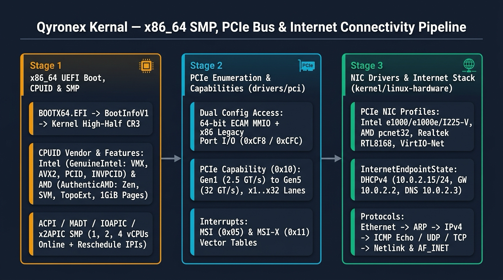

# x86_64 (Intel & AMD), PCIe-Bus & Internet-Netzwerk-Stack

Stand: 21.11.2026

Dieses Dokument beschreibt die **x86_64-Prozessorunterstützung (Intel & AMD)**, die **PCIe-Enumeration** (ECAM + Legacy Port-I/O) sowie die **Ethernet- und Internet-Protokollpipeline** von Qyronex Kernal.

---

## 1. x86_64 Boot, CPUID (Intel & AMD) & SMP (`kernel/arch-x86_64`, `kernel/core`)

1. **UEFI-Handoff (`BOOTX64.EFI` -> `BootInfoV1`):** Normalisiert die physische Speicherkarte und übergibt den Kernel in den High-Half (`CR3`) mit Guard-Stacks, SMEP/NX und Null-Page-Schutz.
2. **ACPI & SMP-Bringup:** Liest `MADT`/`FADT` für `IOAPIC` (24 Redirection Entries), `x2APIC` und `TSC`-Kalibrierung. Startet alle Application Processors deterministisch (`1, 2, 4 vCPUs`) inklusive Reschedule-IPI-Nachweis.
3. **Intel- & AMD-Prozessorerkennung (`ProcessorProfile::detect()`):**
   - **Intel (`GenuineIntel`):** `VMX` (VT-x), `AVX2`, `AES-NI`, `PCID`, `INVPCID`, `FSGSBASE`, `RDRAND`, `RDSEED`, `UMIP`, `x2APIC`.
   - **AMD (`AuthenticAMD`):** `SVM` (AMD-V), `Zen` Extended Family/Model, `TopoExt`, `SSE4A`, `ABM/LZCNT`, `SYSCALL/SYSRET`, `1GiB Pages` (`PDPE1GB`), `Invariant TSC` und physische/lineare Adressbreiten (`0x8000_0008`).

---

## 2. PCIe-Enumeration, Capabilities & Interrupts (`drivers/pci`)

- **Dualer Konfigurationszugriff:**
  - **64-Bit PCIe ECAM (`EcamWindow`):** Auf AArch64 (`pci-host-ecam-generic`), Raspberry Pi 4/5 und modernen x86_64-Q35/ACPI-MCFG-Plattformen.
  - **x86 Legacy Port-I/O (`0xCF8` / `0xCFC`):** `legacy_io_config_address(bus, device, function, offset)` für klassische x86-PC-Busse und QEMU `i440fx`/`q35`.
- **PCIe Capability (`0x10`) & Link-Status:** Dekodiert `PcieGen` (`Gen1` 2,5 GT/s bis `Gen5` 32,0 GT/s), ausgehandelte Lane-Breite (`x1..x32`), `link_training` und `dll_link_active`.
- **MSI (`0x05`) & MSI-X (`0x11`):** Liest 64-Bit-MSI-Fähigkeit, Vektoranzahl, BAR-Index (`table_bir`) und Table-Offset aus dem Konfigurationsraum.

---

## 3. NIC-Treiberprofile & Internet-Stack (`kernel/linux-hardware/src/nic.rs`)

- **Hardware-Profile (`PciNicModel`):**
  - **Intel:** `e1000` (`8086:100E`), `e1000e` (`8086:10D3`), `I210` (`8086:1533`), `I225-V` (`8086:15F3`, 2,5 GbE).
  - **AMD / Realtek / VirtIO:** `PCnet-PCI` (`1022:2000`), `RTL8168` (`10EC:8168`), `VirtIO-Net` (`1AF4:1000`/`1041`).
  - **Raspberry Pi:** `LAN7515` (Pi 3B+), `BCM2711 GENET v5` (Pi 4B), `RP1 Cadence GEM` (Pi 5).
- **Internet-Stack (`InternetEndpointState` & `kernel/linux-net`):**
  - DHCPv4-Lease (`10.0.2.15/24`, Gateway `10.0.2.2`, DNS `10.0.2.3`), ARP-Auflösung, IPv4-Routing, ICMP Echo (`build_icmp_echo_frame` / `synthesize_icmp_echo_reply`), UDP, TCP, `AF_UNIX` und Netlink.
